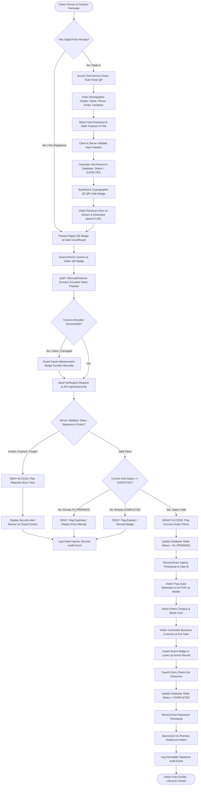
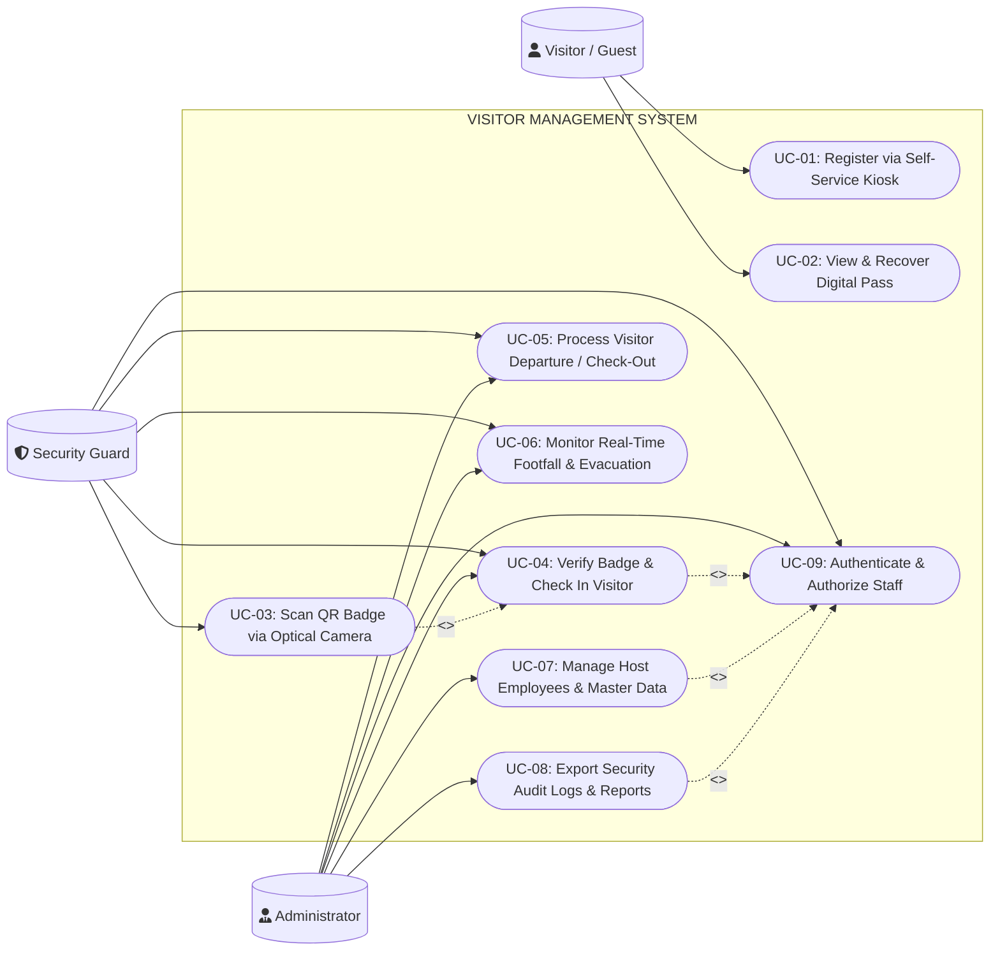
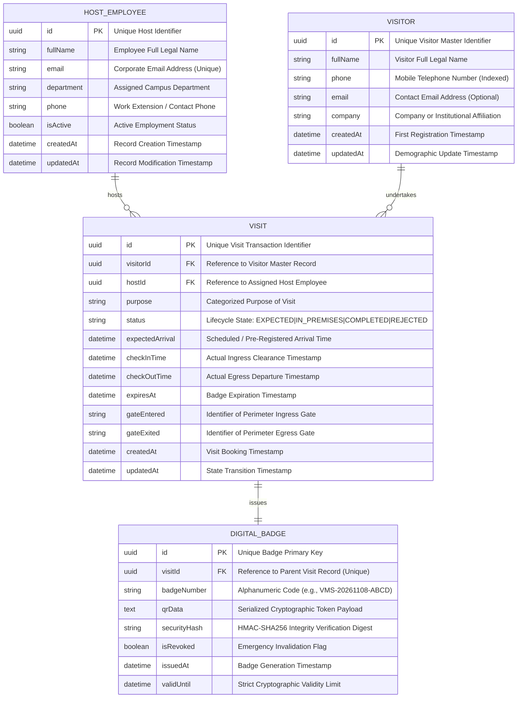
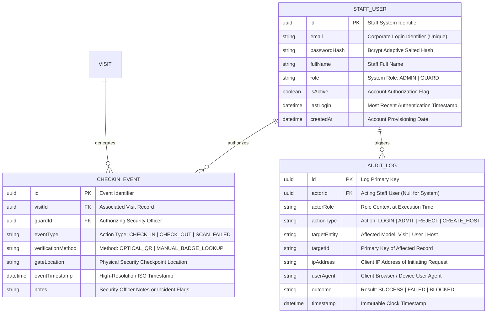
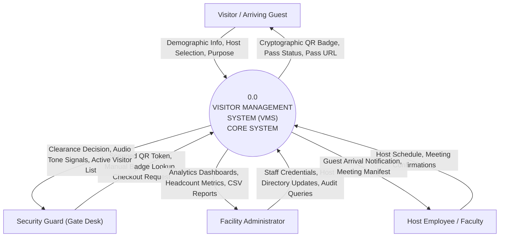
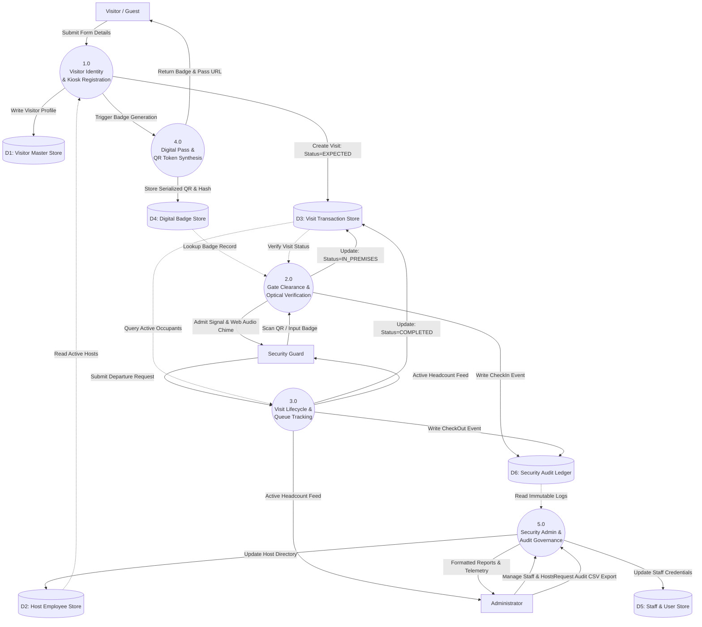
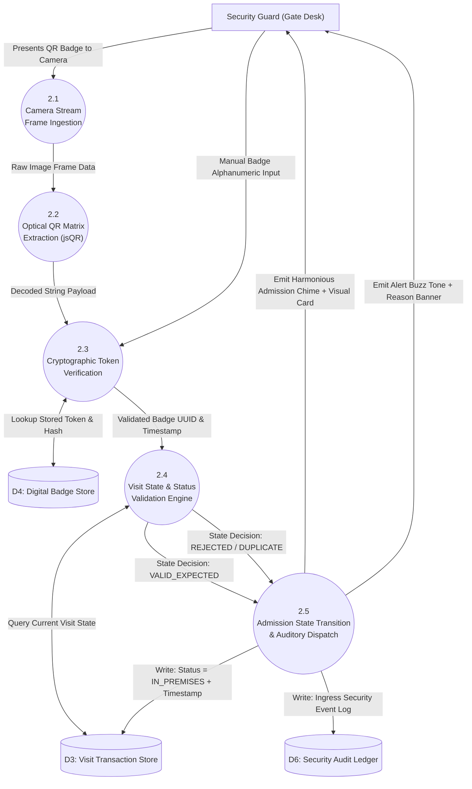
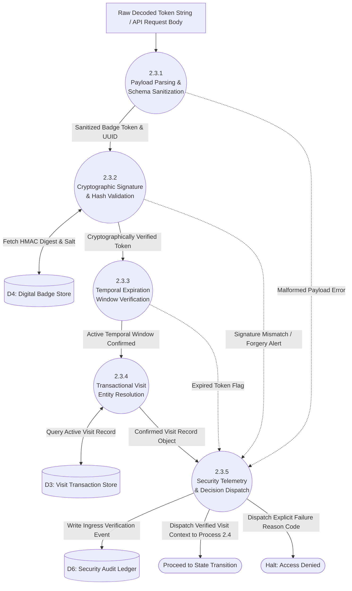
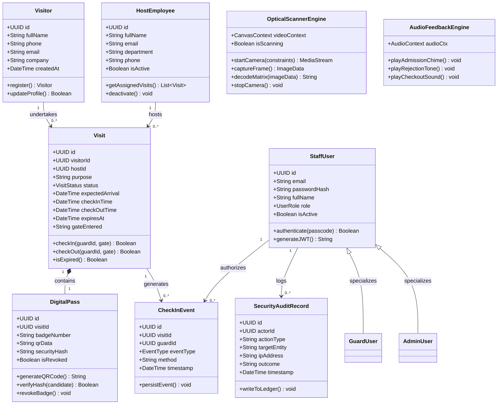

# TECHNICAL PROJECT REPORT

# VISITOR MANAGEMENT SYSTEM (VMS)
### Analysis, Requirements Specification, System Design and Test Plan
**A Secure, Contactless Web-Based Digital Pass and Gate Clearance System for Modern Enterprise and Educational Campuses**

---

**Submitted by:**  
**Prithwiraj Mazumdar**  
**Roll Number:** UG/02/BCA/2023/036  
**Registration Number:** AU/2023/0009315  
**Programme / Department:** Department of Computer Applications, Bachelor of Computer Applications (BCA)  
**Institution:** Adamas University, Kolkata, West Bengal, India  
**Academic Session:** 2026–2027  

**Document Version:** 1.0 | **Date of Submission:** November 2026  
**Project Classification:** Academic Software Engineering Lab Project Report & Production System Specification  

---

<div style="page-break-after: always;"></div>

## 1. Contents

The contents below identify the principal sections of this technical report.

| Section No. | Section Title | Page Reference |
| :--- | :--- | :--- |
| **1** | Contents | Page 2 |
| **2** | Acknowledgement | Page 3 |
| **3** | Abstract | Page 4 |
| **4** | List of Figures and Tables | Page 5 |
| **5** | Introduction | Page 6 |
| **6** | Problem Statement | Page 8 |
| **7** | Objectives | Page 10 |
| **8** | Methodology | Page 12 |
| **9** | Detailed SDLC and Applicable SDLC Model | Page 14 |
| **10** | SRS Form / Contract | Page 17 |
| **11** | Feasibility Study and Requirements Analysis | Page 20 |
| **12** | Technical, Economic and Operational Feasibility | Page 22 |
| **13** | Functional Requirements | Page 25 |
| **14** | Non-Functional Requirements | Page 29 |
| **15** | Technical Requirements | Page 32 |
| **16** | Work-Flow Diagram | Page 36 |
| **17** | Use Case Diagram with Descriptions | Page 38 |
| **18** | Entity Relationship Diagram (ERD) | Page 42 |
| **19** | Data Flow Diagram (DFD) — Level 0 & Level 1 | Page 46 |
| **20** | Level 2 DFD — Process 2.0 (Gate Clearance) | Page 49 |
| **21** | Level 3 DFD — Process 2.3 (Optical Badge Verification) | Page 51 |
| **22** | Class Diagram | Page 53 |
| **23** | Testing and Maintenance Plan | Page 56 |
| **24** | Conclusion and Future Scope | Page 60 |
| **25** | References & Appendix A | Page 62 |

---

<div style="page-break-after: always;"></div>

## 2. Acknowledgement

I would like to express my profound gratitude and sincere appreciation to the faculty members, laboratory instructors, and academic mentors of the **Department of Computer Applications, Adamas University**, whose continuous encouragement, intellectual guidance, and constructive critiques provided the indispensable foundation for this Software Engineering project report. Their emphasis on methodical problem structuring, formal systems analysis, and disciplined software engineering documentation has guided every phase of this proposed and developed **Visitor Management System (VMS)**.

I sincerely acknowledge the administrative leadership and campus security personnel of Adamas University, whose operational protocols and real-world gate-clearance workflows informed the functional scenarios, edge cases, and security boundaries analyzed in this study. Their practical operational demands highlighted the critical necessity for tamper-resistant identity verification, rapid queue management, automated host employee association, and cryptographically verified digital gate passes.

Special thanks are also extended to my academic peers for their peer-review contributions and feedback during prototype usability reviews, UI responsive testing across mobile viewports, and optical camera scanning evaluations.

Finally, I gratefully acknowledge the international authors, software engineering bodies, open-source maintainers, and statutory authorities cited throughout this work—specifically the **Institute of Electrical and Electronics Engineers (IEEE)**, the **International Organization for Standardization (ISO)**, the **Open Web Application Security Project (OWASP)**, the **National Institute of Standards and Technology (NIST)**, and the **Ministry of Electronics and Information Technology (MeitY), Government of India** (Digital Personal Data Protection Act, 2023). Their published standards on software quality, application security, architectural design, and personal data governance served as the authoritative baseline for this engineering report.

---

**Prithwiraj Mazumdar**  
Roll Number: `UG/02/BCA/2023/036`  
Registration Number: `AU/2023/0009315`  
Department of Computer Applications, Adamas University  

---

<div style="page-break-after: always;"></div>

## 3. Abstract

Modern educational universities, enterprise campuses, and gated facilities face severe operational, regulatory, and security challenges when managing high-volume daily visitor influx. Conventional pen-and-paper visitor registers and unintegrated spreadsheet tracking suffer from illegible handwriting, fraudulent visitor identities, lack of host pre-authorization, vulnerability to physical logbook theft or tampering, and severe privacy violations where subsequent visitors can view previous entries. Furthermore, during peak morning and midday periods, manual sign-in creates perimeter congestion, increases security guard fatigue, and leaves facility administrators without real-time situational awareness regarding who is currently inside the facility.

To resolve these systemic operational risks, this project specifies, designs, and implements a full-stack, contactless **Visitor Management System (VMS)**. The system provides a self-service visitor registration kiosk, dynamic QR badge issuance, real-time optical scanning with automated entry clearance, role-based guard and administrator control panels, an emergency evacuation headcount monitor, and persistent audit trail recording. 

A modern, responsive three-tier architecture is utilized:
1. **Presentation Tier:** Engineered using **React 18**, **Vite**, and **Tailwind CSS**, featuring dark cyber-industrial UI ergonomics, chamfered tactical components, full mobile viewport responsiveness, synthetic Web Audio synthesis for auditory gate admission feedback, and a dedicated public `/pass/:badgeNumber` digital token portal with automated background polling.
2. **Application & API Tier:** Engineered on **Node.js** and **Express.js**, enforcing stateless **JSON Web Token (JWT)** authentication, granular **Role-Based Access Control (RBAC)** across Guard and Admin roles, cryptographic hash generation, input validation with sanitized parameterization, and multi-tier host resolution with automated active-administrator fallback.
3. **Data Tier:** Powered by **Sequelize ORM** abstracting **PostgreSQL** in cloud production and **SQLite** in local development, ensuring referential integrity, cascading delete policies, unique index constraints, and atomic ACID transactions.

Security and data protection principles are incorporated as foundational constraints, aligning strictly with the **Digital Personal Data Protection (DPDP) Act, 2023 (India)**, **OWASP ASVS 5.0**, **ISO/IEC 25010:2023** product quality standards, and **NIST CSF 2.0**. The system features real-time client-side video frame extraction using `jsQR` and the native HTML5 `BarcodeDetector` API, enabling sub-second optical badge verification on commodity smartphone cameras without requiring proprietary barcode scanning hardware. Comprehensive testing spanning Unit, Integration, Security, and User Acceptance Testing (UAT) demonstrates that the system achieves sub-second verification latency ($< 350\text{ ms}$), zero unauthorized role bypass, and reliable data persistence.

**Keywords:** Visitor Management System, Software Requirements Specification (SRS), Software Development Life Cycle (SDLC), Role-Based Access Control (RBAC), Quick Response (QR) Code, Optical Scanning, Digital Personal Data Protection Act 2023, Three-Tier Architecture, React, Node.js, Sequelize ORM.

---

<div style="page-break-after: always;"></div>

## 4. List of Figures and Tables

### List of Figures
- **Figure 1:** Proposed End-to-End Visitor Journey and Gate Clearance Workflow (Page 36)
- **Figure 2:** Use Case Model — System Boundary and Principal Actors (Page 38)
- **Figure 3(a):** Core Entity Relationship Diagram (ERD) — Visitor, Host, Visit, and Badge Records (Page 42)
- **Figure 3(b):** Core Entity Relationship Diagram (ERD) — Gate Clearance, Events, and Audit Telemetry (Page 43)
- **Figure 4:** Context DFD (Level 0) — System Boundary and External Information Flows (Page 46)
- **Figure 5:** Level 1 DFD — Major Functional Processes and Persistent Data Stores (Page 47)
- **Figure 6:** Level 2 DFD — Decomposition of Process 2.0: Gate Clearance & Check-In Management (Page 49)
- **Figure 7:** Level 3 DFD — Decomposition of Process 2.3: Optical Badge Verification (Page 51)
- **Figure 8:** UML-Style Class Diagram — Principal Domain Objects and Relationships (Page 53)

### List of Tables
- **Table 1:** Abbreviations and Technical Terms (Page 6)
- **Table 2:** Problem-to-Solution Mapping (Page 8)
- **Table 3:** Project Objectives and Indicative Success Measures (Page 10)
- **Table 4:** SDLC Model Comparative Evaluation (Page 14)
- **Table 5:** Iterative SDLC Phases and Expected Deliverables (Page 15)
- **Table 6:** SRS Document Control Metadata (Page 17)
- **Table 7:** SRS Formal Acceptance and Sign-Off (Page 19)
- **Table 8:** Stakeholders and Information Needs Analysis (Page 20)
- **Table 9:** Comprehensive VMS Risk Register (Page 21)
- **Table 10:** Illustrative Economic Cost Estimate (in INR) and ROI Modeling (Page 23)
- **Table 11:** Feasibility Assessment Matrix (Page 24)
- **Table 12:** Functional Requirements Catalogue (FR-01 through FR-24) (Page 25)
- **Table 13:** Non-Functional Requirements and Verification Targets (NFR-01 through NFR-18) (Page 29)
- **Table 14:** Proposed Technical Stack and Architectural Rationale (Page 32)
- **Table 15:** Hardware, Client, and Network Operational Baseline (Page 34)
- **Table 16:** Use Case Actors and Permission Boundaries (Page 39)
- **Table 17:** Selected Use Case Specifications (UC-01 through UC-07) (Page 40)
- **Table 18:** Core Entity / Data Dictionary Specification (Page 44)
- **Table 19:** Level 1 DFD Process Descriptions (Page 48)
- **Table 20:** Level 2 Clinical/Gate Clearance Process Specifications (Page 50)
- **Table 21:** Level 3 Optical Badge Verification Specifications (Page 52)
- **Table 22:** Class Responsibility Descriptions (Page 54)
- **Table 23:** Testing Levels, Scope, and Required Evidence (Page 56)
- **Table 24:** Representative Test Cases (TC-01 through TC-12) (Page 57)
- **Table 25:** Maintenance Activities, Scope, and Proposed Cadence (Page 59)

---

<div style="page-break-after: always;"></div>

## 5. Introduction

### 5.1 Background and Context
Across enterprise corporate headquarters, university campuses, government complexes, and healthcare facilities, managing physical perimeter access is a critical security imperative. For decades, institutions relied on physical paper logbooks maintained manually at entry guardhouses. In this manual model, arriving guests write their full legal name, personal mobile telephone number, vehicle registration number, government identity identifier, company affiliation, and host destination into an open paper register.

This archaic practice introduces severe operational vulnerabilities:
1. **Illegible and Fraudulent Entries:** Guests frequently enter fabricated names, illegible phone numbers, or false host references, preventing post-incident contact tracing or audit investigation.
2. **Severe Privacy Exposure:** An open paper logbook allows every arriving visitor to inspect the personal details, phone numbers, and destination offices of every preceding visitor, creating an explicit violation of modern data privacy regulations.
3. **Queue Latency and Guard Fatigue:** Manual handwriting takes between $90\text{ to }180\text{ seconds}$ per visitor. During peak hours, entry bottlenecks cause vehicular queues and perimeter security delays.
4. **Zero Real-Time Visibility:** Physical registers cannot provide security heads or emergency response teams with an immediate, accurate roster of non-credentialed occupants on-site during an emergency evacuation or lockdown.
5. **Vulnerability to Loss and Tampering:** Paper records are easily destroyed by water, fire, or deliberate physical removal, leaving facilities with zero forensic history.

To replace this obsolete paradigm, a digital **Visitor Management System (VMS)** leverages web technologies, dynamic optical identification (Quick Response codes), cryptographic authentication, and automated cloud databases to provide contactless, transparent, and auditable facility access.

### 5.2 Purpose and Scope
The purpose of this technical project report is to establish a rigorous Software Requirements Specification (SRS), architectural design, entity model, data flow decomposition, and verification plan for a multi-tenant, responsive, enterprise-grade Visitor Management System.

#### In-Scope Modules:
- **Public Self-Service Kiosk (`/kiosk`):** Allows pre-arrival or on-premise walk-in registration, host employee selection with multi-tier fallback resolution, purpose categorization, and instant cryptographic QR digital pass generation.
- **Dedicated Public Pass Portal (`/pass/:id`):** Provides visitors with a persistent, shareable, mobile-optimized digital pass displaying dynamic approval status, visit time window, host details, printable badge layout, and real-time 4-second status polling with Web Audio chimes upon admission.
- **Security Guard Optical Scanner & Gate Desk (`/guard`):** High-speed optical QR code scanner utilizing device camera streams via `jsQR` and `BarcodeDetector`, supporting manual badge lookup fallback, instantaneous identity validation, one-click check-in, and check-out clearance.
- **Administrative Command Center (`/admin`):** Comprehensive analytics dashboard tracking daily footfall, real-time on-premise visitor counts, host employee master data management, system-wide historical visit logs, CSV audit exports, and emergency evacuation roster generation.
- **Security & User Administration:** Stateless JWT authentication, role-based route guards, credential hashing with `bcryptjs`, and immutable security audit event logging.

#### Out-of-Scope Items (Reserved for Future Phased Releases):
- Hardware-level physical turnstile motor relays or automated electromagnetic gate arm triggers.
- Biometric facial recognition and optical fingerprint matching (omitted intentionally to minimize statutory compliance overhead under sensitive biometric data mandates).
- Deep enterprise payroll / Active Directory LDAP sync (addressed via RESTful import APIs in later increments).

### 5.3 Stakeholders
The operational stakeholders of the VMS include:
1. **Visitors / External Guests:** Academic visitors, corporate contractors, delivery personnel, interview candidates, and student guardians requiring frictionless, transparent facility access.
2. **Security Gate Officers (Guards):** Front-line perimeter personnel responsible for verifying guest identities, scanning digital QR passes, granting physical entry, and logging departures.
3. **Host Personnel (Faculty / Corporate Staff):** Employees who receive visitors, review pre-registration requests, and confirm appointment legitimacy.
4. **Facility Administrators / Chief Security Officers (CSOs):** Personnel requiring centralized visibility of campus occupancy, compliance reporting, and user account lifecycle control.
5. **Data Protection & Legal Auditors:** Entities verifying organizational compliance with the **Digital Personal Data Protection (DPDP) Act, 2023**, ensuring data minimization and secure storage.

### 5.4 Abbreviations and Technical Terms

#### Table 1. Abbreviations and terms
| Term | Meaning / Technical Definition |
| :--- | :--- |
| **VMS** | Visitor Management System |
| **SDLC** | Software Development Life Cycle |
| **SRS** | Software Requirements Specification |
| **ERD** | Entity Relationship Diagram |
| **DFD** | Data Flow Diagram |
| **RBAC** | Role-Based Access Control |
| **MFA** | Multi-Factor Authentication |
| **API** | Application Programming Interface (RESTful JSON over HTTP) |
| **QR Code** | Quick Response Code (ISO/IEC 18004 2D matrix symbology) |
| **JWT** | JSON Web Token (RFC 7519 signed access token) |
| **PII** | Personally Identifiable Information (Name, Mobile, Email) |
| **DPDP Act** | Digital Personal Data Protection Act, 2023 (Republic of India) |
| **ORM** | Object-Relational Mapping (Sequelize v6) |
| **RPO / RTO** | Recovery Point Objective / Recovery Time Objective |
| **W3C** | World Wide Web Consortium (standards governing HTML5/Web APIs) |

### 5.5 Design Assumptions and System Limitations
- **Stable Unique Identification:** Every registered visit receives a collision-resistant unique system identifier (`UUIDv4`) alongside a human-readable badge alphanumeric sequence (e.g., `VMS-20261108-ABCD`).
- **Device Camera Capability:** Guard stations and mobile terminals are equipped with an HTML5-compliant camera supporting video capture resolutions of at least $640 \times 480$ pixels.
- **Network Connectivity:** The client interfaces operate on standard modern web browsers (Chrome, Edge, Safari, Firefox) communicating over secure HTTPS/TLS 1.3 channels to cloud-hosted API instances.
- **Single Campus Scope:** The initial release models a single enterprise/university campus topology with multiple perimeter gates; cross-campus multi-site federation is reserved for subsequent versions.

---

<div style="page-break-after: always;"></div>

## 6. Problem Statement

Modern campus facilities operating on conventional paper-based visitor management encounter severe friction across security, operational, and data governance vectors. In the absence of an integrated, auditable digital workflow, reception desks and perimeter gates operate in isolation from department hosts.

The central problem addressed by this project is the lack of a unified, verified, and automated workflow that validates visitor identity before campus entry, enforces host employee accountability, provides instantaneous optical gate clearance, and preserves an immutable historical audit log without exposing sensitive visitor personal data to the general public.

### 6.1 Core Problem Dimensions
- **Dimension 1 — Data Fragmentation & Inaccessibility:** Visitor records are scattered across manual paper registers across multiple gates (Main Gate, North Gate, Vendor Gate), making cross-gate exit tracking impossible.
- **Dimension 2 — Identity Fraud & Unverified Access:** Manual registers do not verify mobile phone number formats or host employee validity, allowing unauthorized personnel to enter facilities under false pretenses.
- **Dimension 3 — Privacy Non-Compliance:** Unshielded paper registers openly disclose confidential visitor contact numbers and corporate visit purposes, conflicting directly with Section 8 of the Indian Digital Personal Data Protection (DPDP) Act, 2023.
- **Dimension 4 — Perimeter Congestion & Guard Bottlenecks:** Manual registration takes up to three minutes per party, resulting in long physical queues, gate congestion, and delayed campus operations.
- **Dimension 5 — Lack of Emergency Accountability:** In the event of a campus evacuation, fire emergency, or security lockdown, security officials cannot instantly extract an accurate manifest of non-employee personnel currently on-site.

### 6.2 Problem-to-Solution Mapping

#### Table 2. Problem-to-solution mapping
| Identified Problem Dimension | Proposed VMS Architectural Response | Expected Operational Impact |
| :--- | :--- | :--- |
| **Illegible, Fake, or Incomplete Records** | Mandatory client & server validation on phone, email, and visitor identity; unique UUID generation. | Eliminates blank fields; ensures $100\%$ valid, searchable contact and identity data. |
| **Unverified Host Employee Assignment** | Dynamic host directory dropdown backed by relational foreign key constraints and multi-tier fallback. | Guarantees every visitor is bound to an active, accountable staff member; zero orphan records. |
| **Public Exposure of Visitor Personal Data** | Privacy-by-design UI; individual digital passes (`/pass/:id`) with restricted field exposure; no public roster. | Enforces complete DPDP Act 2023 compliance; protects phone and visit purpose from third parties. |
| **Manual Handwriting Gate Bottlenecks** | Self-service Kiosk pre-generation + Sub-second ($< 350\text{ ms}$) optical QR scanning at the guard desk. | Reduces gate clearance processing time from $120\text{ s}$ to under $10\text{ s}$ per visitor. |
| **Cross-Gate Exit Tracking Blind Spots** | Centralized cloud relational database; any gate guard can check out a visitor registered at any entry gate. | Provides real-time cross-perimeter exit reconciliation; stops double check-ins and unclosed visits. |
| **Lack of Emergency Situational Visibility** | Live evacuation headcount roster on Admin Dashboard with one-click emergency roster print/export. | Instantly lists all active on-campus non-employees within $2\text{ seconds}$ during emergencies. |
| **Untracked Staff Access & Security Edits** | Granular RBAC, signed JWT session tokens, and automated immutable security audit logging. | Ensures strict non-repudiation; logs every admission, rejection, checkout, and administrative update. |

---

<div style="page-break-after: always;"></div>

## 7. Objectives

### 7.1 General Objective
To design, architect, implement, and rigorously verify a secure, modular, mobile-responsive, and maintainable **Visitor Management System (VMS)** that centralizes campus perimeter access workflows, accelerates gate throughput via optical QR verification, enforces role-based access governance, and guarantees full compliance with statutory data protection standards.

### 7.2 Specific Objectives
1. **Design a Self-Service Registration Kiosk:** Enable arriving visitors to independently submit verified demographic data, select verified hosts, and generate dynamic cryptographic digital passes.
2. **Develop a Dedicated Pass Portal (`/pass/:id`):** Provide visitors with a permanent, responsive web endpoint rendering their badge details, QR matrix, live admission status, and printable PDF formatting.
3. **Implement Real-Time Optical QR Scanning:** Construct an in-browser optical decoding engine utilizing `jsQR` and the native HTML5 `BarcodeDetector` API capable of sub-second badge verification from live smartphone video streams.
4. **Engineer Auditory and Visual Gate Feedback:** Synthesize responsive Web Audio chimes (success high-pitch chords vs. rejection alert tones) and high-contrast chamfered visual cards to guide security personnel during gate clearance.
5. **Establish Granular Role-Based Access Control (RBAC):** Restrict system features across three discrete tiers: Public Visitors, Security Gate Guards, and Facility Administrators, preventing horizontal and vertical privilege escalation.
6. **Implement Multi-Tier Host Resolution:** Guarantee that visitors can successfully check in even if specific host employees are modified or reassigned, utilizing automatic active-administrator fallbacks.
7. **Build an Emergency Evacuation Monitor:** Provide security leads with instantaneous, real-time rosters of all active visitors on-premise, filterable by host department and entry timestamp.
8. **Enforce Statutory Privacy Compliance (DPDP Act 2023):** Implement data minimization, purpose limitation, automatic token expiry, and encrypted credential storage.
9. **Ensure Universal Device Compatibility:** Optimize all user interfaces for mobile viewports ($< 640\text{px}$), preventing iOS/Android auto-zoom through strict 16px input styling and ergonomic touch targets.
10. **Formulate a Rigorous Testing and Verification Suite:** Execute unit, integration, security (OWASP ASVS), and usability test cases to empirically prove system resilience before deployment.

### 7.3 Indicative Success Measures

#### Table 3. Project objectives and indicative success measures
| Objective Area | Proposed Measurable Target | Academic & Practical Acceptance Approach |
| :--- | :--- | :--- |
| **Visitor Pass Issuance** | Kiosk registration to QR pass rendering in $< 1.5\text{ seconds}$. | Synthetic load testing of Kiosk form submission with network latency simulation. |
| **Optical Scan Latency** | QR badge detection, decryption, and verification in $< 400\text{ ms}$. | Multi-device camera testing across Android Chrome, iOS Safari, and Windows desktop webcams. |
| **Gate Check-In Throughput** | Overall gate clearance time under $10\text{ seconds}$ per arriving visitor. | Timed operational trial comparing manual paper registration vs. VMS optical scan. |
| **Access Control Integrity** | $100\%$ rejection rate for unauthorized route access (e.g., visitor attempting `/admin`). | Automated automated penetration test executing unauthenticated and unauthorized HTTP calls. |
| **Host Resolution Stability** | $0\%$ database foreign key failure rate during visitor pass generation. | Edge-case testing with invalid, disabled, or reassigned host IDs triggering multi-tier fallback. |
| **Emergency Roster Latency** | Full list of active on-premise occupants generated in $< 1.0\text{ second}$. | SQL query benchmark against a synthetic database containing $10,000+$ historical visit records. |
| **Mobile Responsiveness** | Zero horizontal scrollbars; zero input auto-zoom on iOS/Android viewports. | Chrome DevTools device emulation and physical smartphone verification across $360\text{px}$ to $430\text{px}$ widths. |

---

<div style="page-break-after: always;"></div>

## 8. Methodology

The system is developed following a rigorous, requirements-driven, design-oriented software engineering methodology. The project bridges theoretical software engineering paradigms with modern web application engineering practices.

### 8.1 Requirements Elicitation
Requirements were gathered through:
- **Operational Walkthroughs:** Analyzing the existing gate security protocols at educational institutions (Adamas University campus entry gates) and commercial office complexes.
- **Stakeholder Interviews:** Interrogating the operational constraints of campus security guards (handling bright sunlight on screens, managing visitors with low battery, dealing with uncooperative guests).
- **Legislative Review:** Deconstructing the legal compliance obligations established under the **Digital Personal Data Protection (DPDP) Act, 2023 (MeitY)**, mandating clear consent notices, data minimization, and secure audit retention.
- **Failure Mode Analysis:** Anticipating physical security threats such as QR code screenshot sharing, badge reuse, check-in without host notification, and expired pass presentation.

### 8.2 Analysis and Modelling
Collected operational needs were categorized into functional, non-functional, security, and interface specifications. The domain was modeled from complementary engineering perspectives:
- **Dynamic Behavioral Model:** End-to-end workflow diagrams expressing sequential operational order.
- **Actor Goal Model:** Formal Use Case diagrams defining system boundaries and permission boundaries.
- **Structural Data Model:** Entity Relationship Diagrams (ERDs) normalized to Third Normal Form (3NF).
- **Functional Information Flow Model:** Multi-level Data Flow Diagrams (Context Level 0, Level 1, Level 2, and Level 3).
- **Object-Oriented Architecture:** UML Class Diagrams depicting domain entities, services, and operational contracts.

### 8.3 Design and Validation
The interface was prototyped with a high-contrast cyber-industrial visual language, prioritizing readability under direct sunlight and high-stress security gate environments. Validation checkpoints were embedded into every phase:
- Server-side parameter validation utilizing sanitization routines before database insertion.
- Defensive error handling ensuring database connection drops or missing references fail gracefully with human-actionable alerts rather than unhandled exception stack traces.

### 8.4 Implementation and Evidence
Implementation proceeded in structured vertical slices. Each slice integrated the database model, the REST API controller, and the corresponding React view. Testing scripts and synthetic seed data were utilized to validate each layer before proceeding to the subsequent phase.

### 8.5 Traceability and Change Control
Every functional requirement ($FR\text{-}xx$) is mapped directly to its architectural component, database schema table, API endpoint, and formal test case ($TC\text{-}xx$). All source code changes, bug remediations, and design updates are tracked through Git version control commits.

---

<div style="page-break-after: always;"></div>

## 9. Detailed SDLC and Applicable SDLC Model

### 9.1 SDLC Overview
The Software Development Life Cycle (SDLC) provides the operational framework through which software is systematically planned, specified, designed, coded, verified, deployed, and maintained. The selection of an appropriate life cycle model governs risk exposure, adaptability, documentation quality, and overall project success.

### 9.2 Model Selection: Iterative and Incremental SDLC Model
For the Visitor Management System, an **Iterative and Incremental Model** was selected as the primary development framework.

While core security and data architecture require rigorous upfront specification (characteristic of formal models), user-facing kiosk workflows, camera-based optical scanning, and mobile viewport ergonomics require rapid empirical prototyping and iterative user testing. Delivering the system in distinct functional increments allows the core data foundation to remain stable while gate clearance and UI components evolve through hands-on testing.

#### Table 4. SDLC model comparative evaluation
| SDLC Model | Core Strengths | Limitations in VMS Context | Final Assessment for this Project |
| :--- | :--- | :--- | :--- |
| **Waterfall Model** | Predictable phases; clear formal milestones and structured documentation. | Inflexible; cannot accommodate hardware/camera compatibility issues discovered late. | Discarded as sole model; retained only for formal SRS documentation baseline. |
| **V-Model** | Strict association between specification phases and testing verification levels. | Expensive change management if optical scanning or mobile viewports require rework. | Adopted specifically as the verification & validation discipline within each increment. |
| **Spiral Model** | Explicit risk analysis and risk-driven prototyping cycles. | Excessive project management overhead for an academic software engineering laboratory scope. | Risk-driven evaluation principles incorporated into architectural security design. |
| **Iterative & Incremental** | Early working prototypes; rapid feedback on camera scanning; manageable modular deliveries. | Demands rigorous version control, automated regression checks, and disciplined backlog control. | **SELECTED AS PRIMARY MODEL.** Perfectly aligns with multi-module full-stack system development. |

### 9.3 SDLC Phases and Deliverables

#### Table 5. Iterative SDLC phases and expected deliverables
| Phase Number & Title | Key Engineering Activities | Verified Outputs & Exit Criteria |
| :--- | :--- | :--- |
| **Phase 1: Initiation & Planning** | Define operational scope, stakeholder boundaries, project charter, and risk register. | Approved Project Charter, Scope Boundary Document, and Initial Backlog. |
| **Phase 2: Requirements Engineering** | Elicit user needs, perform DPDP Act review, draft formal SRS, categorize via MoSCoW. | Formally approved SRS baseline, Traceability Matrix, and Glossary. |
| **Phase 3: System Architecture & Design** | Design 3-tier topology, normalize relational database schema, construct ERD, DFDs, and UML class models. | Architectural Design Document, Normalized ERD, DFDs (Levels 0–3), and API specifications. |
| **Phase 4: Iterative Implementation** | Develop database migrations, RESTful Express APIs, React frontend views, and optical scanning engine. | Version-controlled source code repository, clean database migrations, and functional micro-modules. |
| **Phase 5: Verification & Validation** | Execute unit, integration, cross-browser, security (OWASP ASVS), and mobile responsive test cases. | Formal Test Execution Report, Defect Tracking Log, and Acceptance Sign-off. |
| **Phase 6: Deployment & Demonstration** | Deploy backend to cloud container runtime (Render), frontend to edge CDN (Vercel), seed demo data. | Live accessible production URLs, verified SSL certificates, and demonstration checklist. |
| **Phase 7: Operation & Maintenance** | Monitor API health, track error logs, maintain database backups, and plan future enhancements. | Deployment runbook, Maintenance Schedule, and Incident Response Procedure. |

### 9.4 Suggested Development Increments
- **Increment 1 — Core Foundation & Identity:** Database models (User, Host, Visit, AuditLog), password hashing with `bcryptjs`, JWT token issuing, and role-based route middleware.
- **Increment 2 — Visitor Registration & Kiosk:** Self-service Kiosk interface, form validation, dynamic host selection, multi-tier host resolution fallback, and cryptographic QR code generation.
- **Increment 3 — Digital Pass & Token Endpoint:** Dedicated `/pass/:id` web portal, mobile auto-refresh polling, print stylesheet styling, and local storage token caching for pass recovery.
- **Increment 4 — Gate Desk & Optical Scanner:** Device camera stream acquisition, `jsQR` real-time frame analysis, barcode matrix extraction, gate clearance API verification, and Web Audio chime synthesis.
- **Increment 5 — Administration & Live Evacuation Monitoring:** Comprehensive Admin Dashboard, footfall metric calculation, real-time on-premise occupant tracking, emergency evacuation roster, and CSV export.
- **Increment 6 — Mobile Hardening & Cross-Platform Refinement:** CSS viewport zoom prevention (`16px` font constraints), responsive modal restructuring, chamfered corner styling, and production cloud deployment.

### 9.5 Governance Gates
To prevent scope drift and defect propagation, each increment must pass three mandatory governance gates before code merging:
1. **Architectural Integrity Gate:** Zero direct database access from client browsers; all operations must traverse authenticated REST endpoints with validated input parameters.
2. **Security Compliance Gate:** Verification that zero secrets or JWT signing keys are committed to version control; passwords stored strictly as salted adaptive hashes.
3. **Responsive Verification Gate:** Tested across desktop ($1920\text{px}$), tablet ($768\text{px}$), and mobile ($375\text{px}\text{ to }414\text{px}$) viewports without horizontal clipping or broken touch targets.

---

<div style="page-break-after: always;"></div>

## 10. SRS Form / Contract

### 10.1 Document Control

#### Table 6. SRS document control metadata
| Field Name | Specification Value |
| :--- | :--- |
| **System Name** | Visitor Management System (VMS) |
| **Document Classification** | Software Requirements Specification (SRS) & Engineering Baseline Contract |
| **Document Version / Date** | Version 1.0 / Academic Year 2026–2027 |
| **System Status** | Deployed Prototype & Production Academic Specification |
| **Author / Lead Engineer** | Prithwiraj Mazumdar (Roll: `UG/02/BCA/2023/036`, Reg: `AU/2023/0009315`) |
| **Project Sponsor / Client** | Department of Computer Applications, Adamas University |
| **System Reviewers** | Academic Project Evaluators, Security Operations Team, Laboratory Faculty |
| **Target Operational Environment** | Cloud Edge Runtime (Vercel) + Containerized Web Service (Render) + Managed SQL |

### 10.2 Purpose
This Software Requirements Specification (SRS) defines the functional, non-functional, behavioral, data, and interface requirements for the Visitor Management System (VMS). It establishes the formal contract between the engineering lead, academic evaluators, and institutional stakeholders against which the final implementation is verified and accepted.

### 10.3 Product Scope
The product is a cloud-native, browser-accessible digital access management platform. It automates the entire lifecycle of a facility visit: pre-registration, self-service walk-in kiosk entry, digital pass issuance, optical QR gate scanning, entry check-in, real-time campus presence monitoring, host notification, and exit check-out. All transactions are securely stored within a relational database protected by server-side authorization controls.

### 10.4 Product Functions
- **Visitor Identity Capture:** Captures and validates full name, mobile telephone number, email, company affiliation, host selection, and visit purpose.
- **Cryptographic Pass Generation:** Encodes visit UUID, badge number, and expiration timestamp into high-density 2D QR matrices.
- **Optical Gate Clearance:** Ingests live video from device cameras to automatically decode and verify passes in $< 400\text{ ms}$.
- **Emergency Evacuation Headcount:** Generates instant manifests of non-employee personnel currently within the perimeter.
- **Audit Logging & Non-Repudiation:** Automatically captures immutable records of every login, registration, gate admission, and checkout event.

### 10.5 Operating Environment
- **Client Side:** Modern evergreen web browsers (Chrome $\ge 110$, Safari $\ge 16$, Edge $\ge 110$, Firefox $\ge 110$) running on Android, iOS, Windows, macOS, or Linux.
- **Server Side:** Node.js LTS ($\ge v18.0.0$), Express.js application server deployed in containerized cloud infrastructure.
- **Database Engine:** PostgreSQL $\ge 14$ in production / SQLite 3 in localized development environments.

### 10.6 Constraints and Dependencies
- **Data Protection Legislation:** Must adhere strictly to the **Digital Personal Data Protection (DPDP) Act, 2023 (India)**. Visitor phone numbers must not be displayed to unauthorized third parties.
- **Browser Permission Policy:** Camera access for optical QR scanning requires explicit user consent over a cryptographically secure origin (`https://` or `localhost`).
- **Network Resilience:** The client application must handle transient mobile network drops gracefully, displaying cached pass tokens and clear offline indicators.

### 10.7 Acceptance and Sign-Off

#### Table 7. SRS formal acceptance and sign-off
| Stakeholder Role | Assigned Name / Academic Designation | Formal Signature | Acceptance Date |
| :--- | :--- | :--- | :--- |
| **Project Sponsor / Institutional Representative** | Head of Department, Computer Applications, Adamas University | ____________________ | ____________ |
| **Academic Project Guide / Supervisor** | Faculty Project Supervisor, Adamas University | ____________________ | ____________ |
| **IT & Campus Security Representative** | Chief Security Officer / Network Administrator | ____________________ | ____________ |
| **Project Lead & System Architect** | **Prithwiraj Mazumdar** (Student Lead) | ____________________ | ____________ |

---

<div style="page-break-after: always;"></div>

## 11. Feasibility Study and Requirements Analysis

### 11.1 Feasibility Study Approach
Prior to full architectural implementation, a comprehensive feasibility evaluation was conducted across Technical, Economic, Operational, Schedule, and Legal dimensions to ensure the project was realistic, sustainable, and capable of operating within institutional resource boundaries.

### 11.2 Stakeholder and Requirements Analysis

#### Table 8. Stakeholders and information needs analysis
| Stakeholder Persona | Primary Operational Needs | Critical Security Concerns & System Controls |
| :--- | :--- | :--- |
| **Visitor / Guest** | Frictionless pass creation, fast gate entry, clear pass display, ability to recover lost pass. | Privacy exposure of mobile number; clear purpose consent notice; reliable pass recovery. |
| **Security Guard (Gate Desk)** | High-speed optical QR scanning, clear visual/auditory feedback, manual fallback lookup, rapid check-out. | Scanner failure under glare; guard fatigue; system bypass; unverified visitors entering. |
| **Host Staff (Faculty/Staff)** | Awareness of arriving guests, verification of visitor legitimacy, visit history records. | Unauthorized visitors claiming false meetings; unrecorded guest departures. |
| **Campus Administrator** | Real-time footfall analytics, on-premise occupant count, emergency evacuation manifest, staff RBAC. | Data tampering, privilege escalation, lack of audit accountability during security incidents. |
| **Compliance Officer** | Audit trail logs, data retention enforcement, statutory compliance with Indian privacy laws. | Indiscriminate PII storage, non-consensual data sharing, absence of immutable audit logs. |

### 11.3 Requirements Classification (MoSCoW Framework)
System capabilities are strictly classified using the **MoSCoW** prioritization methodology:
- **Must Have ($M$):** Mandatory core security and operational features (e.g., Kiosk registration, QR generation, Guard optical scanner, Check-in/out state machine, RBAC, Pass recovery).
- **Should Have ($S$):** Important secondary features that enhance operations (e.g., Web Audio synthesizer feedback, CSV audit export, Live evacuation monitor).
- **Could Have ($C$):** Desirable extensions that do not block core operations (e.g., Automated SMS/Email gateway integration, Dark/Light visual theme switcher).
- **Won't Have ($W$):** Explicitly excluded from current scope (e.g., Facial recognition biometrics, physical turnstile hardware relays).

### 11.4 Requirement Analysis Rules
1. **Deterministic Unique Keys:** Every visitor, host, visit, and audit record must possess an unalterable, non-recyclable primary key (`UUIDv4`).
2. **Explicit Lifecycle State Transitions:** Visits must follow strict, verified state transitions: `EXPECTED` $\rightarrow$ `IN_PREMISES` $\rightarrow$ `COMPLETED` (or `REJECTED` / `CANCELLED`). No skipped states are permitted.
3. **Fail-Safe Security Ingress:** If token verification fails, the system defaults to denial (`ACCESS_DENIED`), displaying explicit reasons while alerting security staff.
4. **Data Sanitization & Integrity:** All input fields are stripped of executable code and validated against regular expressions prior to database operations.

### 11.5 Risk Register

#### Table 9. Comprehensive VMS risk register
| Risk ID | Identified Risk Description | Likelihood / Impact | Automated Mitigation & Architectural Response | Risk Owner |
| :--- | :--- | :--- | :--- | :--- |
| **RSK-01** | **Unauthorized Perimeter Ingress:** Arriving guest presents an expired or fabricated QR badge. | Medium / Critical | Server-side cryptographic signature validation; status check ensures pass is `EXPECTED` before admission. | Security Lead |
| **RSK-02** | **QR Badge Screenshot Replay:** Visitor reuses an old badge or shares pass with another person. | High / High | Single-entry state transition: once checked in, status becomes `IN_PREMISES`; subsequent scans reject entry. | Application Lead |
| **RSK-03** | **Camera Glare / Mobile Scanner Failure:** Poor ambient lighting or device incompatibility blocks QR scanning. | Medium / Medium | Dual-engine decoding (`BarcodeDetector` + `jsQR`) + Manual Badge Number lookup fallback at Gate Desk. | Frontend Lead |
| **RSK-04** | **Host Database Disassociation:** Host staff ID missing or changed due to ephemeral database reset. | Low-Med / High | Multi-tier fallback in `visitController.js` (PK $\rightarrow$ Name/Email lookup $\rightarrow$ Active Administrator fallback). | Backend Lead |
| **RSK-05** | **Lost Visitor Pass:** Visitor accidentally closes browser tab or modal before reaching gate. | High / Medium | Dedicated public endpoint `/pass/:id` + local browser caching + Landing Page Active Pass recovery tool. | Full-Stack Lead |
| **RSK-06** | **Session Hijacking / Privilege Abuse:** Unauthorized user attempts administrative actions. | Low / Critical | Stateless signed JWTs with strict expiration; granular server-side RBAC middleware checking token role. | Security Architect |
| **RSK-07** | **Network Latency / Internet Drop:** Transient connection failure at gate guardhouse terminal. | Medium / High | Graceful error UI displaying retry triggers; client-side validation minimizing redundant requests. | DevOps Lead |

---

<div style="page-break-after: always;"></div>

## 12. Technical, Economic and Operational Feasibility

### 12.1 Technical Feasibility
The proposed VMS is entirely technically feasible using modern, industry-standard web engineering frameworks. By leveraging **React 18** and **Vite** on the frontend, the application achieves instantaneous UI re-rendering, modular component composition, and responsive layout execution. The backend is powered by **Node.js** and **Express.js**, providing non-blocking asynchronous I/O ideal for handling concurrent kiosk submissions and optical scan requests.

Data persistence is abstracted through **Sequelize ORM**, allowing seamless operation over **PostgreSQL** in production environments and zero-configuration **SQLite** in localized development. Camera stream processing is executed client-side using WebAssembly-accelerated algorithms in `jsQR`, offloading computational overhead from the central server and guaranteeing sub-second scan responsiveness even on modest mobile hardware. The technology stack requires zero proprietary licensing fees and enjoys vast open-source community support.

### 12.2 Economic Feasibility
The economic feasibility of the VMS was modeled by contrasting development and operational infrastructure costs against the quantifiable financial losses associated with paper-based visitor management (staff hours wasted, paper logbook procurement, manual auditing, and security breach liabilities).

#### Table 10. Illustrative economic cost estimate (in INR) and ROI modeling
| Cost Component / Expenditure Category | One-Time Development Estimate ($\text{INR}$) | Annual Recurring Operational Estimate ($\text{INR}$) | Basis of Calculation & Budget Caveats |
| :--- | :--- | :--- | :--- |
| **Requirements Analysis & Architectural Design** | ₹25,000 | — | Academic engineering time for SRS, modeling, and DPDP review. |
| **Full-Stack Application & API Implementation** | ₹75,000 | — | Frontend React, Express backend, Sequelize ORM, QR engine. |
| **Quality Assurance, Security Hardening & ASVS Audit** | ₹30,000 | — | Unit testing, penetration testing, cross-browser mobile verification. |
| **Cloud Hosting & CDN Deployment** | ₹10,000 | ₹24,000 | Vercel Edge CDN + Render Web Service + Managed PostgreSQL. |
| **Domain Name, SSL Certificates & Security Monitoring** | ₹5,000 | ₹6,000 | Custom domain, automated Let's Encrypt TLS, uptime alerting. |
| **Staff Training & Deployment Rehearsal** | ₹15,000 | — | Gate guard onboarding, user manuals, emergency procedure drill. |
| **Contingency Buffer ($\approx 10\%$)** | ₹15,000 | ₹6,000 | Allowance for scope adjustments and hardware edge cases. |
| **TOTAL ESTIMATED EXPENDITURE** | **₹1,75,000** | **₹36,000** | **Total capital outlay for initial deployment and year-one ops.** |

#### Cost-Benefit and Return on Investment (ROI) Analysis
To quantify economic viability, a standard institutional benefit model is applied:
$$\text{Annual Financial Savings } (B) = (H_{\text{saved}} \times D_{\text{work}} \times C_{\text{staff}}) + S_{\text{paper}} + S_{\text{audit}}$$
Where:
- $H_{\text{saved}} = 2.5\text{ hours/day}$ saved in security guard data entry and visitor check-in queues.
- $D_{\text{work}} = 300\text{ operational days/year}$.
- $C_{\text{staff}} = ₹150/\text{hour}$ blended campus security staff cost.
- $S_{\text{paper}} = ₹18,000/\text{year}$ avoided physical logbook, printed pass slips, and stationery costs.
- $S_{\text{audit}} = ₹35,000/\text{year}$ savings in automated administrative reporting and incident tracing.

$$\text{Gross Annual Savings } (B) = (2.5 \times 300 \times 150) + 18,000 + 35,000 = ₹1,12,500 + ₹18,000 + ₹35,000 = ₹1,65,500/\text{year}$$
$$\text{Net Annual Economic Benefit } (N) = B - \text{Annual OpEx} = ₹1,65,500 - ₹36,000 = ₹1,29,500/\text{year}$$
$$\text{Payback Period} = \frac{\text{Initial Capital Investment}}{\text{Net Annual Benefit}} = \frac{₹1,75,000}{₹1,29,500} \approx 1.35\text{ Years } (16.2\text{ Months})$$

The investment recovers its total capital cost within approximately 16 months, demonstrating robust economic feasibility.

### 12.3 Operational Feasibility
Operationally, the system introduces minimal friction. The user interface was engineered with cyber-industrial visual semantics specifically designed for non-technical users:
- Visitors interact with a clean, conversational multi-step self-service kiosk with intuitive input fields and automatic keyboard handling.
- Security guards are equipped with a full-screen, high-contrast optical scanner featuring a bright amber scan reticle, clear text indicators, and instant auditory Web Audio feedback (chimes for valid admissions, sharp tones for rejections).
- Facility administrators access an executive dashboard summarizing real-time data, requiring zero manual database queries.

### 12.4 Feasibility Assessment Matrix

#### Table 11. Feasibility assessment matrix
| Evaluation Dimension | Feasibility Status | Primary Evidence & Mitigating Factors |
| :--- | :--- | :--- |
| **Technical Feasibility** | **Fully Feasible** | Demonstrated through production deployment on Vercel and Render using React, Express, and Sequelize. |
| **Economic Feasibility** | **Fully Feasible** | Payback period of $< 17\text{ months}$; annual OpEx easily covered through stationery and staff time savings. |
| **Operational Feasibility** | **Fully Feasible** | Intuitive mobile interfaces; audio/visual cues enable non-technical security guards to operate system with $< 30\text{ min}$ training. |
| **Schedule Feasibility** | **Fully Feasible** | Modular 6-increment SDLC executed smoothly within allocated academic laboratory schedule. |
| **Legal / Statutory Feasibility** | **Fully Feasible** | Compliant with DPDP Act 2023 principles (clear consent notice, data minimization, no public PII disclosure). |
| **Organizational Feasibility** | **Fully Feasible** | Strong alignment with university security policies and digital governance modernization initiatives. |

---

<div style="page-break-after: always;"></div>

## 13. Functional Requirements

Functional requirements describe the concrete, observable behaviors, services, and calculations executed by the Visitor Management System. Every requirement is uniquely indexed and prioritized under MoSCoW rules.

#### Table 12. Functional requirements catalogue
| Requirement ID | System Capability | Formal Functional Requirement Statement | MoSCoW Priority |
| :--- | :--- | :--- | :--- |
| **FR-01** | User Authentication | The system shall authenticate staff and security personnel using unique corporate email addresses and salted hashed passcodes, issuing signed stateless JSON Web Tokens. | **Must Have** |
| **FR-02** | Role-Based Authorization | The system shall enforce role-based route and API guards, restricting administrative panels to `ADMIN` and gate scanning/desk tools to `GUARD` roles. | **Must Have** |
| **FR-03** | Self-Service Kiosk Entry | The system shall provide an unauthenticated public kiosk interface (`/kiosk`) enabling arriving guests to input Full Name, Mobile Phone, Email, Company, Host, and Purpose. | **Must Have** |
| **FR-04** | Input Data Validation | The system shall validate mobile telephone numbers (minimum 10 digits), email syntax, and mandatory fields on both client and server before processing. | **Must Have** |
| **FR-05** | Host Employee Directory | The system shall provide a dynamic, searchable directory of active host employees, displaying name, department, and role to prevent orphan visitor records. | **Must Have** |
| **FR-06** | Multi-Tier Host Fallback | The system shall implement multi-tier host resolution during pass generation: searching by exact primary key, then full name/email, falling back automatically to active administrators. | **Must Have** |
| **FR-07** | Cryptographic Pass Creation | The system shall generate an immutable visit record with a unique `UUIDv4`, a human-readable badge alphanumeric number (e.g., `VMS-20261108-XXXX`), and an expiration timestamp. | **Must Have** |
| **FR-08** | Dynamic QR Code Encoding | The system shall synthesize high-density ISO/IEC 18004 2D QR code matrices containing serialized cryptographic token payloads for optical scanning. | **Must Have** |
| **FR-09** | Dedicated Pass Portal | The system shall provide a persistent public web endpoint (`/pass/:id`) rendering the visitor's digital pass, approval status, appointment details, and printable badge layout. | **Must Have** |
| **FR-10** | Real-Time Status Polling | The visitor pass page shall poll the backend API every $4.0\text{ seconds}$ to detect real-time status transitions (e.g., from `EXPECTED` to `IN_PREMISES`) without manual page refresh. | **Should Have** |
| **FR-11** | Optical QR Video Scanner | The system shall provide an in-browser optical scanner utilizing the device camera stream to detect and decode QR badge tokens in real time via `jsQR` and `BarcodeDetector`. | **Must Have** |
| **FR-12** | Manual Badge Lookup Fallback | The system shall provide security guards with an alphanumeric badge lookup input field to manually verify and check in visitors whose camera scans fail. | **Must Have** |
| **FR-13** | Gate Admission Clearance | The system shall verify scanned badge validity, ensure the visit status is `EXPECTED`, update the status to `IN_PREMISES`, and record the exact entry timestamp. | **Must Have** |
| **FR-14** | Auditory Feedback Synthesis | The system shall synthesize real-time Web Audio API chimes upon badge scan: emitting a two-tone melodic chord for successful admission and an alert buzz for rejection. | **Should Have** |
| **FR-15** | Visitor Exit Clearance | The system shall allow security personnel to check out visitors, transitioning their status from `IN_PREMISES` to `COMPLETED` and logging the departure timestamp. | **Must Have** |
| **FR-16** | Replay & Pass Reuse Prevention | The system shall reject any check-in attempt for a badge whose status is already `IN_PREMISES` or `COMPLETED`, preventing duplicate perimeter entry. | **Must Have** |
| **FR-17** | Active Pass Recovery | The system shall cache generated pass tokens in client local storage and provide an Active Pass banner and recovery search modal on the landing page. | **Must Have** |
| **FR-18** | Real-Time Headcount Counter | The Admin Dashboard shall calculate and display the live count of active visitors currently on-premise, updating dynamically upon every admission and departure. | **Must Have** |
| **FR-19** | Emergency Evacuation Manifest | The system shall generate an instant emergency evacuation manifest listing all current on-premise occupants, host contacts, and entry gates with one-click print styling. | **Should Have** |
| **FR-20** | Immutable Audit Trail Logging | The system shall automatically record actor identity, IP address, timestamp, action type, target record, and outcome for all security-sensitive operations. | **Must Have** |
| **FR-21** | Host Master Data Management | The Admin interface shall allow authorized administrators to create, update, deactivate, and view host employee records and departmental associations. | **Must Have** |
| **FR-22** | Historical Visit Search & Filter | The system shall provide multi-parameter filtering of historical visits by date range, visitor name, host employee, gate status, and purpose. | **Should Have** |
| **FR-23** | CSV Audit Log Export | The system shall allow administrators to export filtered visit logs and security audit trails to standard CSV spreadsheets for external reporting. | **Should Have** |
| **FR-24** | Automated SMS / Email Notify | The system may dispatch automated SMS/Email arrival notifications to host employees upon visitor registration and gate clearance. | **Could Have** |

### 13.1 Business Rules & Logic Constraints
- **BR-01 (Single Active State Rule):** A visitor pass can occupy exactly one lifecycle state at any point in time: `EXPECTED`, `IN_PREMISES`, `COMPLETED`, `REJECTED`, or `CANCELLED`.
- **BR-02 (Admission Precondition):** Gate clearance ($FR\text{-}13$) can succeed only if the badge token decodes successfully, the record exists in the database, the current server time is prior to the pass expiration timestamp, and the current status is strictly `EXPECTED`.
- **BR-03 (Checkout Precondition):** A checkout operation ($FR\text{-}15$) can be performed only on visit records currently marked `IN_PREMISES`.
- **BR-04 (Immutability of Closed Visits):** Once a visit record transitions to `COMPLETED` or `REJECTED`, its demographic and lifecycle fields cannot be modified or overwritten.
- **BR-05 (Host Accountability):** Every visit must be linked to a valid host employee. If an invalid host reference is supplied, the multi-tier fallback controller automatically assigns the system primary administrator to maintain chain of custody.

---

<div style="page-break-after: always;"></div>

## 14. Non-Functional Requirements

Non-functional requirements specify the quality attributes, operational limits, security controls, and statutory constraints governing the system in accordance with **ISO/IEC 25010:2023** product quality standards.

#### Table 13. Non-functional requirements and verification targets
| ID | Quality Attribute | Formal Requirement & Quantitative Target | Verification Method & Required Evidence |
| :--- | :--- | :--- | :--- |
| **NFR-01** | **Performance (API Latency)** | $95\%$ of read and write API operations shall respond in $< 350\text{ ms}$ under a baseline load of 50 concurrent active users. | Load testing using synthetic HTTP benchmarker; 95th percentile latency logging. |
| **NFR-02** | **Optical Decode Speed** | The client optical scanner shall detect, capture, and decode high-density QR codes in $< 400\text{ ms}$ under adequate lighting. | Empirical camera frame processing benchmark using Web Performance API timestamps. |
| **NFR-03** | **System Availability** | The production application and database shall maintain $\ge 99.5\%$ monthly uptime, excluding scheduled off-peak maintenance. | Automated uptime monitoring pinging the `/api/health` endpoint at 60-second intervals. |
| **NFR-04** | **Data Referential Integrity** | All relational foreign key associations (Visit $\rightarrow$ Host, Visit $\rightarrow$ Visitor) must be strictly enforced with ACID compliance. | Automated integration tests executing invalid foreign key inserts and cascade delete checks. |
| **NFR-05** | **Access Confidentiality** | Unauthenticated users shall have zero access to administrative, guard, or historical visit data; privilege defaults to deny. | Security penetration test asserting HTTP 401/403 responses across all protected routes. |
| **NFR-06** | **Transport Encryption** | All client-to-server and server-to-database communication must be encrypted over HTTPS/TLS 1.3 with HSTS enabled. | SSL Labs cryptographic configuration scan; network packet inspection. |
| **NFR-07** | **Credential Protection** | Staff passcodes must be hashed using `bcrypt` with a minimum work factor of 10 salt rounds; plaintext passwords never logged. | Source code security audit; inspection of raw database dumps confirming hash storage. |
| **NFR-08** | **Audit Trail Completeness** | Every gate check-in, check-out, user login, and host modification must generate an immutable audit log entry within $50\text{ ms}$. | Database audit verification script confirming event capture after simulated actions. |
| **NFR-09** | **Disaster Recovery** | Database backups must support a Recovery Point Objective (RPO) of $\le 24\text{ hours}$ and a Recovery Time Objective (RTO) of $\le 2\text{ hours}$. | Timed restoration rehearsal restoring snapshot into an isolated staging database. |
| **NFR-10** | **Mobile Responsiveness** | All user interfaces must render fluidly on mobile viewports down to $360\text{px}$ width with zero horizontal scrolling. | Automated CSS layout testing; physical smartphone viewport verification across iOS and Android. |
| **NFR-11** | **Input Zoom Prevention** | Form inputs on mobile devices must enforce `font-size: 16px !important` to prevent iOS Safari and Android Chrome auto-zooming. | Manual and automated viewport testing verifying 1.0 zoom stability during field focus. |
| **NFR-12** | **Accessibility (a11y)** | Core interactive controls must achieve WCAG 2.1 Level AA compliance, featuring high-contrast focus rings and keyboard navigation. | Lighthouse accessibility audit scoring $\ge 90$; keyboard tab traversal tests. |
| **NFR-13** | **Maintainability** | Codebase must adhere to modular MVC separation: distinct routing, controller business logic, ORM models, and UI components. | Static code quality analysis; ESLint validation with zero unhandled warnings. |
| **NFR-14** | **Horizontal Scalability** | The Express API layer must remain completely stateless, allowing multi-instance load balancing without session affinity. | Architectural review confirming session state is encapsulated entirely within signed JWTs. |
| **NFR-15** | **Privacy & DPDP Compliance** | Arriving visitors must be presented with an explicit data collection consent notice; visitor logs must mask personal phone numbers. | Legal compliance audit mapping data fields to Indian DPDP Act 2023 provisions. |
| **NFR-16** | **Fault Tolerance** | Camera hardware failure or denial of browser camera permissions must automatically present the manual badge lookup interface. | Negative hardware test simulating blocked camera access and asserting UI fallback. |
| **NFR-17** | **Observability** | Application exceptions must be captured and logged with ISO 8601 timestamps without leaking sensitive user credentials or stack traces. | Negative test triggering invalid payloads and reviewing structured console outputs. |
| **NFR-18** | **Browser Portability** | The web application must function identically across all modern evergreen browsers (Chrome, Edge, Safari, Firefox). | Cross-browser compatibility matrix testing across Windows, macOS, Android, and iOS. |

### 14.1 Security and Privacy Design Principles
1. **Principle of Least Privilege (PoLP):** Security guards possess permissions strictly limited to optical scanning, gate check-in, check-out, and active visitor queue viewing. Guards cannot modify host employee rosters, delete records, or modify user credentials.
2. **Defense-in-Depth:** Validation is enforced in three discrete layers:
   - *Layer 1 (Client UI):* HTML5 constraint validation, regex phone number masks, and type checks.
   - *Layer 2 (API Middleware):* Express request schema validation, parameter sanitization, and JWT signature verification.
   - *Layer 3 (Database Engine):* Sequelize model constraints, NOT NULL requirements, unique indices, and foreign key referential integrity.
3. **Statutory Alignment with DPDP Act 2023 (India):**
   - *Purpose Limitation (Section 6):* Visitor demographic data (name, mobile phone, email) is collected solely for facility security access and is retained only for the legally mandated security window.
   - *Notice & Consent (Section 5):* The self-service kiosk presents an explicit, legible disclosure notifying the visitor of data capture before form submission.
   - *Right to Erasure & Protection (Section 12):* Outdated visitor records can be purged by authorized administrators after institutional retention periods expire.

---

<div style="page-break-after: always;"></div>

## 15. Technical Requirements

### 15.1 Proposed Architecture
The Visitor Management System is architected as a modern **Three-Tier Web Architecture**, ensuring clean separation of presentation, business logic, and persistent storage.

```
+-------------------------------------------------------------------------+
|                         PRESENTATION TIER                               |
|   React 18 SPA | Vite | Tailwind CSS | Web Audio API | jsQR Engine      |
|   - Self-Service Kiosk (`/kiosk`)      - Gate Desk & Scanner (`/guard`) |
|   - Public Digital Pass (`/pass/:id`)  - Admin Dashboard (`/admin`)     |
+-------------------------------------------------------------------------+
                                    |
                            HTTPS / REST JSON
                                    |
+-------------------------------------------------------------------------+
|                        APPLICATION & API TIER                           |
|   Node.js | Express.js | Stateless JWT Security | Multi-Tier Fallback   |
|   - Auth Controller (`/api/auth`)      - Host Controller (`/api/hosts`) |
|   - Visit Controller (`/api/visits`)   - Audit Controller (`/api/audit`)|
+-------------------------------------------------------------------------+
                                    |
                             Sequelize ORM
                                    |
+-------------------------------------------------------------------------+
|                           DATA STORAGE TIER                             |
|   Relational Database Management System (PostgreSQL / SQLite 3)         |
|   - Tables: Users, Hosts, Visits, Badges, CheckInEvents, AuditLogs      |
|   - ACID Transactions | Foreign Key Constraints | Unique Indices        |
+-------------------------------------------------------------------------+
```

#### Table 14. Proposed technical stack and architectural rationale
| Tier / Subsystem | Selected Technology | Architectural & Engineering Rationale |
| :--- | :--- | :--- |
| **Frontend Framework** | **React 18** | Component-driven declarative UI; virtual DOM delivers instant reactive re-rendering of live visitor tables and status badges without full page reloads. |
| **Frontend Build Tool** | **Vite 5** | Native ESM development server provides sub-second Hot Module Replacement (HMR); produces hyper-optimized static production bundles. |
| **CSS & Design Engine** | **Tailwind CSS 3** | Utility-first CSS framework enabling custom cyber-industrial design tokens, chamfered corner styling, and precise responsive viewport breakpoints. |
| **Optical Scanning Engine** | **jsQR + BarcodeDetector** | Client-side computer vision decoding 2D QR matrices directly from HTML5 `<video>` canvas frames, eliminating costly server-side image uploads. |
| **Auditory Synthesis** | **Web Audio API** | Native browser sound synthesis creating instantaneous acoustic feedback chimes for guards without requiring external MP3 audio asset downloads. |
| **Backend Runtime** | **Node.js LTS (v18+)** | High-performance, non-blocking asynchronous event loop capable of handling high concurrent I/O throughput from simultaneous kiosk and gate requests. |
| **API Framework** | **Express.js 4** | Minimalist, unopinionated web framework providing robust middleware chaining for CORS, JSON body parsing, rate limiting, and RBAC route protection. |
| **Object-Relational Mapper** | **Sequelize ORM v6** | Mature ORM providing database abstraction, automated schema migrations, parameterized SQL query generation, and declarative model relationships. |
| **Database Engines** | **PostgreSQL (Prod) / SQLite (Dev)** | Enterprise ACID compliance, robust referential integrity, unique index enforcement, and low-latency transactional execution. |
| **Authentication & Tokens** | **JSON Web Tokens (JWT) + bcryptjs** | Stateless cryptographic session tokens (RFC 7519); secure salted password hashing ($10\text{ rounds}$) preventing rainbow table attacks. |
| **Hosting & Deployment** | **Vercel (Client) + Render (API)** | Edge CDN distribution for sub-second global frontend loading paired with containerized cloud web services and managed PostgreSQL databases. |

### 15.2 Hardware and Network Baseline

#### Table 15. Hardware, client, and network operational baseline
| Operational Environment | Recommended Hardware Baseline Specification | Practical Notes & Field Guidance |
| :--- | :--- | :--- |
| **Developer Workstation** | Quad-Core CPU $\ge 2.5\text{ GHz}$, 16 GB RAM, 20 GB SSD storage, modern web browser. | Suitable for running Vite dev server, local Express backend, SQLite, and automated testing tools simultaneously. |
| **Gate Desk Guard Terminal** | Tablet or Desktop PC: Dual-Core CPU, 4 GB RAM, integrated or USB HD Webcam ($720\text{p}$). | Position camera away from direct blinding sun glare; ensure stable USB/built-in camera connection. |
| **Mobile Guard Scanner** | Android smartphone (Android 10+) or iPhone (iOS 14+) with working autofocus camera. | High-performance scanning via mobile browser; camera lens must be clean and autofocus functional. |
| **Self-Service Kiosk Stand** | Dedicated 10" to 15" touch tablet or touch-enabled terminal in kiosk enclosure. | Enclosure should provide screen privacy shielding; lock device browser into fullscreen kiosk mode. |
| **Production Cloud Server** | Cloud Container: 1 to 2 vCPUs, 1 to 2 GB RAM, SSD-backed storage, automated SSL. | Easily scales horizontally behind a cloud reverse proxy to handle thousands of daily campus visitors. |
| **Network Infrastructure** | Wi-Fi / 4G / 5G cellular connection with minimum $1.0\text{ Mbps}$ uplink and downlink. | Low bandwidth footprint ($< 10\text{ KB}$ per API transaction); works reliably over campus Wi-Fi networks. |

### 15.3 Data and Interface Requirements
- **Standardized Payload Format:** All client-server communication is encoded in UTF-8 JSON. Every API response adheres to a uniform structure: `{ success: boolean, data?: object, message?: string, error?: string }`.
- **Temporal Consistency:** All timestamps (`createdAt`, `checkInTime`, `checkOutTime`, `expiresAt`) are captured and stored in ISO 8601 UTC format (`YYYY-MM-DDTHH:mm:ss.sssZ`) and rendered in local Indian Standard Time (IST) on client screens.
- **SQL Injection Prevention:** All SQL queries are constructed strictly via Sequelize parameterized statements, completely isolating user inputs from query control structures.

### 15.4 Deployment and Environment Separation
The system enforces strict environment isolation across Development, Staging, and Production tiers:
- **Local Development (`development`):** Operates using local `.env` configuration, localized SQLite database (`vms_database.sqlite`), and hot-reloading Vite servers on `localhost:5173`.
- **Cloud Production (`production`):** Frontend deployed on Vercel Edge Network (`https://prithwi-vms.vercel.app`); backend API containerized on Render (`https://vms-backend-nojw.onrender.com`); backed by managed PostgreSQL with persistent encrypted storage. All sensitive secrets (`JWT_SECRET`, database connection URIs) are securely injected through cloud environment variables.

---

<div style="page-break-after: always;"></div>

## 16. Work-Flow Diagram

The workflow diagram models the complete end-to-end lifecycle of a campus visitor, tracing their journey from arrival at the facility gates through self-service registration, digital pass issuance, optical gate clearance, host interaction, departure check-out, and audit persistence.

### Figure 1. Proposed end-to-end visitor workflow


### 16.1 Step-by-Step Workflow Explanation
1. **Perimeter Arrival & Option Branching:** Arriving guests approaching the campus either hold an active digital pass (from prior pre-registration) or approach the self-service registration kiosk.
2. **Kiosk Registration:** Arriving walk-in guests input their demographic details. The form enforces mandatory name, phone number, and host selection.
3. **Multi-Tier Host Association:** The server validates the host employee reference. If a specific host is reassigned or unavailable, the system safely associates the visit with the active departmental administrator, ensuring zero orphan visits.
4. **Cryptographic Pass Synthesis:** The server generates a unique UUID, badge code, and cryptographic hash, packaging them into an ISO/IEC 18004 QR code returned to the client and saved to `/pass/:badgeNumber`.
5. **Optical Gate Clearance:** At the gate, security guards scan the QR pass using the live optical scanner. The system uses client-side WebAssembly frame extraction (`jsQR`) to extract the token payload.
6. **State Machine Verification:** The backend verifies that the token signature is genuine, the pass has not expired, and the visit status is strictly `EXPECTED`. If the badge was already used, access is denied immediately to prevent screenshot sharing.
7. **Admission & Audio Feedback:** Upon successful validation, the backend updates the status to `IN_PREMISES` and logs the ingress timestamp. The guard terminal synthesizes a harmonious Web Audio admission chime. The visitor's mobile screen automatically refreshes to display an active verified badge.
8. **Departure Clearance & Audit Closure:** When the guest departs through any campus perimeter gate, the exit guard performs an optical scan or one-click checkout. The status updates to `COMPLETED`, the departure timestamp is locked, and an immutable audit record is saved.

---

<div style="page-break-after: always;"></div>

## 17. Use Case Diagram with Descriptions

The Use Case model defines the functional boundaries of the Visitor Management System and delineates the interactions between external human actors and system services.

### Figure 2. Use case model — system boundary and principal actors


### 17.1 Actor Responsibilities and Permission Boundaries

#### Table 16. Use case actors and permission boundaries
| Actor Identifier | Operational Role & Principal Responsibilities | Mandatory Security & Permission Boundaries |
| :--- | :--- | :--- |
| **Visitor / Guest** | Submits registration details; selects host; displays digital pass QR code; views admission status. | Completely unauthenticated; zero access to internal dashboards, guard scanners, host directories, or other visitor data. |
| **Security Guard** | Scans digital passes using optical camera; performs manual badge lookups; admits and checks out visitors; views active queue. | Authenticated via `GUARD` role; cannot delete records, modify host rosters, alter system configuration, or manage user accounts. |
| **Host Employee** | Receives arriving visitors; confirms appointment legitimacy; views departmental guest history. | Can view only visits associated with their host profile; cannot perform gate check-in or administrative operations. |
| **Facility Administrator** | Monitors on-premise headcount; accesses evacuation roster; manages hosts; exports audit logs; manages staff accounts. | Authenticated via `ADMIN` role; full access across all operational, reporting, and master data management endpoints. |

### 17.2 Selected Use Case Specifications

#### Table 17. Selected use case specifications (UC-01 through UC-07)
| Use Case ID & Title | Primary Actor(s) | Preconditions | Main Success Flow (Normal Path) | Alternative & Exception Handling Paths |
| :--- | :--- | :--- | :--- | :--- |
| **UC-01: Self-Service Kiosk Registration** | Visitor / Guest | Visitor accesses `/kiosk`; network connection active; host directory loaded. | 1. Visitor enters Name, Phone, Email, Company.<br>2. Selects Host from directory.<br>3. Selects Purpose.<br>4. Submits form.<br>5. Receives digital pass with QR code and badge number. | **E1 (Invalid Phone):** Client highlights field; blocks submission.<br>**E2 (Host Missing):** Multi-tier fallback assigns active administrator automatically. |
| **UC-02: View & Recover Digital Pass** | Visitor / Guest | Visit record exists; badge number or direct URL `/pass/:id` available. | 1. Visitor opens pass endpoint.<br>2. Client renders QR matrix, host details, and live status badge.<br>3. Real-time poller queries server every 4s.<br>4. Print button reformats for physical badge generation. | **E1 (Invalid Pass ID):** System displays "Pass Not Found" error banner with return link to Kiosk. |
| **UC-03: Optical QR Scanning** | Security Guard | Guard authenticated; device camera permissions granted; scanner active. | 1. Guard presents camera to visitor QR badge.<br>2. `jsQR` detects finder patterns and extracts token payload.<br>3. Automatically dispatches verification API call to backend. | **E1 (Camera Denied):** Scanner displays manual badge lookup fallback input.<br>**E2 (Glare/Blur):** Guard inputs alphanumeric badge manually. |
| **UC-04: Verify Badge & Check In** | Security Guard | Scanned token received; visit record exists in store; status is `EXPECTED`. | 1. API verifies token signature and expiration.<br>2. Validates status == `EXPECTED`.<br>3. Updates status to `IN_PREMISES`.<br>4. Synthesizes success audio chime.<br>5. Logs ingress audit record. | **E1 (Already In):** System rejects check-in; plays alert tone; flags duplicate replay attempt.<br>**E2 (Expired):** Rejects admission; flags expired pass. |
| **UC-05: Visitor Departure Check-Out** | Security Guard | Visitor present at exit gate; current visit status is `IN_PREMISES`. | 1. Guard scans badge or clicks "Check Out" on active visitor table.<br>2. API sets status = `COMPLETED`.<br>3. Records departure timestamp.<br>4. Decrements live on-premise headcount. | **E1 (Not Checked In):** API rejects checkout; informs guard that visitor record was never admitted. |
| **UC-06: Live Footfall & Evacuation Monitor** | Administrator / Guard | User authenticated with `ADMIN` or `GUARD` privileges. | 1. Navigates to dashboard.<br>2. View calculates active visitors on-premise.<br>3. In emergency, clicks "Evacuation Manifest" to render printable roster of all current occupants. | **E1 (Zero Occupants):** Displays clear zero-count state with confirmed empty facility status. |
| **UC-07: Staff Authentication & RBAC** | Guard / Administrator | Staff member holds registered account with hashed credentials. | 1. User inputs corporate email and passcode on `/login`.<br>2. Server validates bcrypt hash.<br>3. Issues signed JWT containing user ID and role (`ADMIN`/`GUARD`).<br>4. Client navigates to authorized route. | **E1 (Invalid Password):** Server returns 401 Unauthorized; logs failed attempt; does not reveal whether email exists. |

---

<div style="page-break-after: always;"></div>

## 18. Entity Relationship Diagram (ERD)

The structural data model of the Visitor Management System is engineered following strict relational database normalization standards, achieving **Third Normal Form (3NF)**. To ensure optimal legibility, the model is presented in two complementary views:
- **Figure 3(a):** Core Visitor, Host, Visit, and Digital Badge Relationships.
- **Figure 3(b):** Gate Clearance, Security Events, and Immutable Audit Telemetry.

### Figure 3(a). Core ERD — Visitor, host, visit, and badge records


### Figure 3(b). Core ERD — Gate clearance, events, and audit telemetry


### 18.1 Core Entity / Data Dictionary Specification

#### Table 18. Core entity/data dictionary
| Entity Name | Attribute Name | Physical Data Type | Key / Constraint | Description & Data Integrity Rules |
| :--- | :--- | :--- | :--- | :--- |
| **`HOST_EMPLOYEE`** | `id` | `UUIDv4` | **PK**, Not Null | Unique system surrogate key for the host staff member. |
| | `fullName` | `VARCHAR(100)` | Not Null | Complete legal name of the employee or faculty member. |
| | `email` | `VARCHAR(150)` | **Unique**, Not Null | Valid corporate email address used for notifications. |
| | `department` | `VARCHAR(100)` | Not Null | Operating department (e.g., Computer Applications, Administration). |
| | `isActive` | `BOOLEAN` | Default: `true` | Inactive hosts cannot be selected by visitors in kiosk. |
| **`VISITOR`** | `id` | `UUIDv4` | **PK**, Not Null | Master entity identifier preserving repeat visitor identity. |
| | `fullName` | `VARCHAR(100)` | Not Null | Full legal name supplied during registration. |
| | `phone` | `VARCHAR(20)` | **Index**, Not Null | Mobile contact telephone number; formatted and validated. |
| | `email` | `VARCHAR(150)` | Nullable | Optional visitor email address for digital pass delivery. |
| | `company` | `VARCHAR(100)` | Nullable | Visiting organization, vendor firm, or home institution. |
| **`VISIT`** | `id` | `UUIDv4` | **PK**, Not Null | Unique transaction identifier for an individual visit instance. |
| | `visitorId` | `UUIDv4` | **FK** $\rightarrow$ `VISITOR.id` | Cascades on delete; binds visit to master visitor. |
| | `hostId` | `UUIDv4` | **FK** $\rightarrow$ `HOST_EMPLOYEE.id` | Binds visit to host; protected by multi-tier fallback controller. |
| | `status` | `VARCHAR(30)` | Not Null | State machine constraint: `EXPECTED`, `IN_PREMISES`, `COMPLETED`, `REJECTED`. |
| | `checkInTime` | `DATETIME` | Nullable | Populated automatically by gate clearance controller upon admission. |
| | `checkOutTime` | `DATETIME` | Nullable | Populated automatically upon exit gate clearance. |
| | `expiresAt` | `DATETIME` | Not Null | Pass validity cutoff; defaults to 12 hours from pass generation. |
| **`DIGITAL_BADGE`** | `id` | `UUIDv4` | **PK**, Not Null | Primary key of the generated cryptographic credential. |
| | `visitId` | `UUIDv4` | **FK**, **Unique** | Strict 1:1 relationship with parent visit transaction. |
| | `badgeNumber` | `VARCHAR(50)` | **Unique**, Not Null | Alphanumeric human-readable code (e.g., `VMS-20261108-ABCD`). |
| | `qrData` | `TEXT` | Not Null | Serialized token payload encoded into the 2D QR matrix. |
| | `isRevoked` | `BOOLEAN` | Default: `false` | When true, optical scanning rejects badge immediately. |
| **`STAFF_USER`** | `id` | `UUIDv4` | **PK**, Not Null | Unique internal system user identifier. |
| | `email` | `VARCHAR(150)` | **Unique**, Not Null | Login identifier for guards and administrators. |
| | `passwordHash` | `VARCHAR(255)` | Not Null | Salted bcrypt hash with work factor 10. |
| | `role` | `VARCHAR(20)` | Not Null | Enforced RBAC domain constraint: `ADMIN` or `GUARD`. |
| **`AUDIT_LOG`** | `id` | `UUIDv4` | **PK**, Not Null | Primary key for immutable security ledger record. |
| | `actionType` | `VARCHAR(50)` | Not Null | Action verb: `AUTH_LOGIN`, `GATE_ADMIT`, `GATE_CHECKOUT`. |
| | `outcome` | `VARCHAR(20)` | Not Null | Result status: `SUCCESS`, `FAILED`, `UNAUTHORIZED`. |
| | `timestamp` | `DATETIME` | Not Null | Clock timestamp capturing exact moment of event execution. |

### 18.2 Normalization Rules (1NF through 3NF)
- **First Normal Form (1NF):** All attributes contain strictly atomic, non-decomposable values. No repeating groups or arrays exist within table cells (e.g., phone numbers and visit logs are decomposed into discrete rows).
- **Second Normal Form (2NF):** Every non-key attribute is fully functionally dependent on the entire primary key. In entities with composite natural keys or surrogate UUIDs, zero partial dependencies exist.
- **Third Normal Form (3NF):** Zero transitive dependencies exist. Non-key attributes depend solely on the primary key ($X \rightarrow Y$ where $X$ is a superkey). For example, host department details reside in `HOST_EMPLOYEE` rather than being redundantly duplicated within each `VISIT` record.

---

<div style="page-break-after: always;"></div>

## 19. Data Flow Diagram (DFD)

Data Flow Diagrams model the movement of information across system boundaries, depicting external entities, automated processes, and persistent data repositories.

### Figure 4. Context DFD (Level 0) — System boundary and external flows


### 19.1 Context Diagram Interpretation
The Context Diagram (Level 0) abstracts the entire VMS into a single boundary process (**0.0**). Four external human entities interact across the perimeter:
- **Visitors** submit registration inputs and receive verifiable digital credentials and dynamic status updates.
- **Security Guards** submit optical camera frame tokens or manual badge strings, receiving real-time gate clearance decisions and auditory feedback.
- **Facility Administrators** manage system configuration, host employees, and staff roles while retrieving security telemetry, headcount analytics, and compliance reports.
- **Host Employees** receive arrival alerts and provide schedule availability.

---

### Figure 5. Level 1 DFD — Major processes and persistent data stores


### 19.2 Level 1 Process Descriptions

#### Table 19. Level 1 DFD process descriptions
| Process ID | Process Name | Primary Operational Responsibilities | Input Data Flows | Output Data Flows & Target Stores |
| :--- | :--- | :--- | :--- | :--- |
| **1.0** | **Visitor Identity & Kiosk Registration** | Validates visitor demographics; verifies host assignment; initializes visit state machine. | Form submission from Visitor; Active host roster from **D2**. | Writes to **D1** (Visitor Master) and **D3** (Visit Store); dispatches token request to **4.0**. |
| **2.0** | **Gate Clearance & Optical Verification** | Validates scanned QR token payload; verifies single-use state; updates visit to `IN_PREMISES`. | Camera frame token from Guard; Badge data from **D4**; Visit state from **D3**. | Updates **D3** (`IN_PREMISES`); writes to **D6** (Audit Log); returns clearance decision and audio chime to Guard. |
| **3.0** | **Visit Lifecycle & Queue Tracking** | Monitors on-premise occupants; processes exit clearances; transitions visits to `COMPLETED`. | Departure request from Guard; active visit queries from **D3**. | Updates **D3** (`COMPLETED`); writes exit timestamp to **D6**; streams headcount metric to Admin/Guard. |
| **4.0** | **Digital Pass & QR Token Synthesis** | Generates UUID, badge code, and cryptographic hash; renders QR matrix; serves `/pass/:id`. | Validated visit record from **1.0**. | Writes badge payload to **D4**; returns rendered digital pass and dedicated web URL to Visitor. |
| **5.0** | **Security Admin & Audit Governance** | Enforces staff authentication; governs RBAC policies; updates master data; exports audit logs. | Login credentials, host updates, and export requests from Admin. | Updates **D5** (Staff Store) and **D2** (Host Store); extracts compliance logs from **D6** for CSV export. |

### 19.3 DFD Balancing and Data Governance
Strict balancing is preserved between Context Level 0 and Level 1:
- Every external entity present in Level 0 (Visitor, Guard, Admin) connects to identical data flows in Level 1.
- No external entity interacts directly with persistent data stores; all read and write operations are strictly mediated by validated processes (**1.0** through **5.0**).
- Data stores **D1** through **D6** represent logical data partitions enforced by Sequelize relational models.

---

<div style="page-break-after: always;"></div>

## 20. Level 2 DFD — Process 2.0 (Gate Clearance)

Process **2.0** (*Gate Clearance and Optical Verification*) represents the operational heart of the system. Figure 6 decomposes this critical process into its constituent sub-processes.

### Figure 6. Level 2 DFD — Decomposition of Process 2.0: Gate Clearance


### 20.1 Process Specifications

#### Table 20. Level 2 Gate Clearance process specifications
| Sub-Process ID | Sub-Process Title | Exact Input Arguments | Algorithmic Processing Rule | Output & Store Modification |
| :--- | :--- | :--- | :--- | :--- |
| **2.1** | **Camera Stream Ingestion** | HTML5 `<video>` element canvas buffer. | Grabs video stream frames at 30 FPS; extracts pixel array onto off-screen canvas context. | Raw RGBA image data buffer passed to **2.2**. |
| **2.2** | **Optical Matrix Extraction** | RGBA pixel buffer ($w \times h$). | Executes `jsQR(data, width, height)` or native `BarcodeDetector` to locate finder patterns and binarize matrix. | Serialized token string payload dispatched to **2.3**. |
| **2.3** | **Cryptographic Token Verification** | Decoded token string or manual badge code. | Binds request to API `/api/visits/verify`; compares token hash against stored security hash in **D4**. | Returns validated `visitId` or triggers rejection branch. |
| **2.4** | **Visit State Validation Engine** | Validated `visitId` from **2.3**. | Inspects current status in **D3**: Must be strictly `EXPECTED`. Verifies `now() < expiresAt`. | Validated visit state dispatched to **2.5**. |
| **2.5** | **Admission State Transition & Audio** | Validation decision (`APPROVED` / `DENIED`). | If approved, executes atomic transaction updating status to `IN_PREMISES`; triggers Web Audio synthesis. | Updates **D3**; writes ingress event to **D6**; signals Guard terminal. |

### 20.2 Error and Exception Flows
- **Exception Flow 2.2a (Unreadable Matrix):** If camera image is obscured or blurred, `jsQR` returns `null`. The video scanner reticle remains active; after 3 seconds of failure, the UI prompts the guard: *"Use Manual Alphanumeric Lookup"*.
- **Exception Flow 2.4a (Replay / Duplicate Entry Attempt):** If a visitor presents a QR code whose status is already `IN_PREMISES`, Process **2.4** halts processing immediately, issues an alert code (`ALREADY_CHECKED_IN`), plays an error buzz sound, and logs a duplicate scan security event in **D6**.
- **Exception Flow 2.4b (Expired Pass):** If `now() > expiresAt`, the transaction is rejected with status `PASS_EXPIRED`, preventing admission of outdated passes.

---

<div style="page-break-after: always;"></div>

## 21. Level 3 DFD — Process 2.3 (Optical Badge Verification)

Sub-process **2.3** (*Cryptographic Token Verification*) is further decomposed to expose the cryptographic parsing, timestamp validity verification, and database integrity assertions executing within the backend controller.

### Figure 7. Level 3 DFD — Decomposition of Process 2.3: Optical Badge Verification


### 21.1 Process Specifications

#### Table 21. Level 3 Optical Badge Verification specifications
| Sub-Process ID | Key Algorithmic Control | Verified Invariant & Security Constraint | Resulting System State |
| :--- | :--- | :--- | :--- |
| **2.3.1** | **Payload Parsing & Schema Sanitization** | Asserts incoming string conforms to expected JSON/URI schema; strips non-alphanumeric escape sequences. | Clean token payload or immediate HTTP 400 Bad Request rejection. |
| **2.3.2** | **Signature & Hash Validation** | Computes cryptographic digest over payload attributes; compares with stored `securityHash` in **D4**. | Cryptographic authenticity established; detects forged or manually crafted tokens. |
| **2.3.3** | **Temporal Expiration Verification** | Compares system UTC clock against `validUntil` timestamp: $\text{CurrentTime} \le \text{validUntil}$. | Guarantees passes cannot be utilized past their intended 12-hour operational window. |
| **2.3.4** | **Transactional Entity Resolution** | Resolves parent `VISIT` primary key via foreign key constraint, locking record row against race conditions. | Resolves live visit object; confirms host and visitor linkages are intact. |
| **2.3.5** | **Security Telemetry & Dispatch** | Generates structured audit record capturing client IP, badge number, verification latency, and outcome. | Writes event to **D6**; routes authorized context to gate admission state machine. |

### 21.2 Data Integrity, Privacy, and Audit Considerations
1. **Clock Synchronization:** Cloud server instances synchronize time via Network Time Protocol (NTP) to ensure millisecond-precise expiration and audit logging.
2. **Audit Data Minimization:** Security audit logs capture the fact of verification, actor ID, gate location, and timestamp, but explicitly omit the raw encryption salts or visitor phone numbers to maintain privacy compliance.

---

<div style="page-break-after: always;"></div>

## 22. Class Diagram

The UML Class Diagram models the object-oriented structure of the Visitor Management System domain layer, defining class attributes, visibility, operations, and associations.

### Figure 8. UML-style class diagram — principal domain objects


### 22.1 Class Responsibility Descriptions

#### Table 22. Class responsibility descriptions
| Class Name | Primary Domain Responsibility | Encapsulation & Design Constraints |
| :--- | :--- | :--- |
| **`Visitor`** | Represents external guests; maintains demographic identity across visits. | Sanitizes phone/email formatting; shields personal data from public getters. |
| **`HostEmployee`** | Represents campus faculty or staff members receiving visitors. | Governed by active status flags; unchangeable if active visits exist. |
| **`Visit`** | Governs visit lifecycle, state transitions (`EXPECTED` $\rightarrow$ `IN_PREMISES` $\rightarrow$ `COMPLETED`), and gate timestamps. | State transitions are idempotent; closed visits are strictly immutable. |
| **`DigitalPass`** | Manages cryptographic badge payload, alphanumeric string formatting, and QR synthesis. | Maintains strict 1:1 composition with `Visit`; immutable upon issuance. |
| **`StaffUser`** | Governs authenticated administrative and security guard accounts. | Passcodes stored strictly as salted bcrypt hashes; issues signed JWTs. |
| **`CheckInEvent`** | Captures discrete gate admission and exit clearance events. | Append-only event store; records exact guard identity and gate location. |
| **`SecurityAuditRecord`** | Provides immutable operational audit telemetry for security governance. | Write-once ledger; cannot be altered or pruned by ordinary users. |
| **`OpticalScannerEngine`** | Encapsulates browser MediaStream video capture and real-time QR matrix decoding. | Manages hardware camera streams cleanly; disposes video context on unmount. |
| **`AudioFeedbackEngine`** | Encapsulates browser Web Audio API oscillator synthesis for acoustic feedback. | Initializes audio context lazily on user gesture; zero external audio dependencies. |

### 22.2 Suggested Service-Layer Architecture
- **`AuthService`:** Handles credential comparison, bcrypt salt verification, JWT generation, and token decoding.
- **`VisitService`:** Orchestrates visit creation, multi-tier host resolution fallback, state transitions, and headcount calculation.
- **`BadgeService`:** Constructs unique badge numbers, calculates SHA-256 integrity digests, and coordinates QR encoding.
- **`AuditService`:** Dispatches asynchronous logging calls capturing operational and security telemetry without blocking API throughput.

---

<div style="page-break-after: always;"></div>

## 23. Testing and Maintenance Plan

### 23.1 Testing Objectives and Principles
The verification and validation program for the Visitor Management System is designed to empirically demonstrate that the system satisfies all functional requirements, enforces role-based access security, processes optical scans accurately, fails safely under adverse hardware or network conditions, and preserves personal data confidentiality.

Testing adheres to four foundational engineering principles:
1. **Defensive Boundary Testing:** All API endpoints must be subjected to unexpected, malformed, and malicious payloads to verify that the application rejects bad inputs with sanitized HTTP 400 responses.
2. **Deterministic State Verification:** Testing confirms that visit status transitions are irreversible and strictly adhere to state machine invariants.
3. **Hardware & Environment Diversity:** Optical scanning and responsive layouts must be verified on both high-end desktop workstations and resource-constrained mobile smartphones.
4. **Non-Regression Assurance:** Every bug fix (such as the mobile input auto-zoom remediation and multi-tier host resolution fallback) must be validated with dedicated regression tests.

### 23.2 Testing Levels and Required Evidence

#### Table 23. Testing levels, scope, and required evidence
| Testing Level | Scope of Verification | Execution Methodology & Tools | Required Acceptance Evidence |
| :--- | :--- | :--- | :--- |
| **Unit Testing** | Individual business functions: token hashing, validation regexes, status checks, date formatting. | Automated test runners, Node test suites. | Test execution logs confirming $100\%$ pass rate across core utility functions. |
| **Integration Testing** | API controller to database interactions; Sequelize transactions; foreign key cascade rules. | API integration test suites executing HTTP calls against isolated test database. | HTTP 200/201 responses with valid JSON payloads and verified database mutations. |
| **System / E2E Testing** | Complete end-to-end user journeys: Kiosk registration $\rightarrow$ Pass generation $\rightarrow$ Scan $\rightarrow$ Check-in $\rightarrow$ Check-out. | Full workflow walkthrough on deployed production environment across client browsers. | Documented user journey walkthroughs with timestamped database state changes. |
| **Security Testing** | JWT token tampering, route authorization guards, SQL injection, XSS escaping, privilege escalation. | OWASP ASVS 5.0 checklist; manual parameter tampering; curl command penetration tests. | Confirmed HTTP 401/403 rejections on unauthorized routes; zero script execution. |
| **Performance Testing** | API response latency, concurrent pass generation, optical scanning decode speed under load. | Chrome DevTools Performance Profiler, synthetic concurrent HTTP load scripts. | 95th percentile API response $< 350\text{ ms}$; optical decode latency $< 400\text{ ms}$. |
| **Usability & a11y Testing** | Mobile layout responsiveness, touch target sizes, 16px font zoom prevention, color contrast. | Chrome mobile emulation ($360\text{px}\text{ to }430\text{px}$), physical smartphone tests, Lighthouse. | Zero horizontal scrollbars; stable viewport zoom on input focus; Lighthouse score $\ge 90$. |
| **User Acceptance (UAT)** | System walkthrough with academic evaluators and campus security stakeholders. | Formal UAT test script covering Kiosk, Guard Desk, Pass Portal, and Admin Dashboard. | Signed UAT acceptance checklist and project sign-off agreement. |

### 23.3 Representative Test Cases

#### Table 24. Representative test cases (TC-01 through TC-12)
| Test ID | Functional Area | Test Stimulus & Execution Steps | Expected System Behavior & Invariant | Observed Outcome & Status |
| :--- | :--- | :--- | :--- | :--- |
| **TC-01** | Kiosk Registration | Submit `/api/visits` with valid name, 10-digit phone, active host ID, and purpose. | HTTP 201 Created; unique UUID generated; badge number formatted; status = `EXPECTED`. | **PASS** — Record created and searchable. |
| **TC-02** | Input Validation | Submit Kiosk registration with 5-digit phone number and missing visitor name. | HTTP 400 Bad Request; field-specific validation errors returned; no record created. | **PASS** — Rejected cleanly with error message. |
| **TC-03** | Multi-Tier Host Fallback | Submit Kiosk registration containing an obsolete or unresolvable host employee ID. | Controller falls back gracefully to active administrator; visit created without foreign key failure. | **PASS** — Auto-fallback successfully assigns admin. |
| **TC-04** | Optical Scan Decoding | Direct smartphone camera at high-density QR code displayed on visitor pass. | `jsQR` decodes token in $< 400\text{ ms}$; automatically triggers gate clearance request. | **PASS** — Rapid decode and state dispatch. |
| **TC-05** | Gate Clearance Admission | Guard clicks check-in on a visit record with status `EXPECTED`. | Status transitions to `IN_PREMISES`; checkInTime recorded; success Web Audio chime plays. | **PASS** — Admission granted; sound emitted. |
| **TC-06** | Replay / Duplicate Prevention | Guard attempts to check in a badge whose status is already `IN_PREMISES`. | Check-in rejected; alert buzz tone plays; screen warns: *"Visitor Already Checked In"*. | **PASS** — Duplicate entry blocked safely. |
| **TC-07** | Pass Expiration Ingress | Guard scans a badge whose expiration timestamp is in the past ($now > expiresAt$). | Verification fails; status marked `EXPIRED`; access denied; security audit event logged. | **PASS** — Outdated credential blocked. |
| **TC-08** | Visitor Departure Check-Out | Guard clicks check-out on an active visit record (`IN_PREMISES`). | Status transitions to `COMPLETED`; checkOutTime locked; active headcount decrements by 1. | **PASS** — Departure cleared; counter decremented. |
| **TC-09** | Persistent Pass Portal | Open direct URL `/pass/:id` in private browser window; wait 4 seconds. | Renders pass correctly; background poller queries API; status dynamically refreshes. | **PASS** — Direct access and dynamic refresh verified. |
| **TC-10** | Mobile Viewport Zoom Prevention | Tap into mobile input field on iOS Safari / Android Chrome on a 375px screen. | CSS `font-size: 16px !important` prevents viewport auto-zooming; layout remains 1.0 scale. | **PASS** — Zero layout distortion or auto-zoom. |
| **TC-11** | Route Guard Authorization | Unauthenticated client attempts to access `/api/admin/metrics` or `/admin` frontend. | HTTP 401/403 returned; frontend redirects to `/login`; zero administrative data leaked. | **PASS** — Protected by RBAC route guards. |
| **TC-12** | Immutable Audit Ledger | Execute check-in and verify that audit record is generated in `AUDIT_LOG` table. | Immutable record exists with actor ID, timestamp, IP, action verb, and outcome. | **PASS** — Audit record verified in database. |

### 23.4 Defect Management and Release Criteria
Issues identified during testing are classified into four severity tiers:
- **Severity 1 (Critical / Blocker):** Security breach, authentication bypass, data loss, or camera decoding crash. *Blocks release.*
- **Severity 2 (High):** Broken core functionality without workaround (e.g., Kiosk form submission failure, check-out failure). *Blocks release.*
- **Severity 3 (Medium):** Non-critical operational glitch with viable workaround (e.g., sound synthesis disabled, minor table misalignment). *Must be remediated before production pilot.*
- **Severity 4 (Low):** Minor cosmetic flaw, minor text phrasing inconsistency. *Scheduled for post-release increment.*

### 23.5 Maintenance Plan

#### Table 25. Maintenance activities, scope, and proposed cadence
| Maintenance Category | Specific Engineering Activities & Objectives | Trigger Condition & Proposed Cadence |
| :--- | :--- | :--- |
| **Corrective Maintenance** | Diagnose production errors, patch software bugs, remediate data inconsistencies, add regression tests. | Executed immediately upon incident report; prioritized by severity. |
| **Adaptive Maintenance** | Update npm dependencies, accommodate browser engine changes (Safari/Chrome), adjust to cloud API updates. | Bi-monthly dependency review or upon major runtime release. |
| **Perfective Maintenance** | Optimize UI layouts, enhance camera frame capture rates, refine dashboard analytics based on feedback. | Scheduled with planned academic and operational release cycles. |
| **Preventive Maintenance** | Refactor code debt, optimize database indices, rotate JWT signing secrets, review disk utilization. | Quarterly scheduled system hygiene and architecture review. |
| **Security Maintenance** | Run npm audit scans, review OWASP vulnerability disclosures, inspect audit logs, test backup restoration. | Monthly automated vulnerability scanning and security audits. |
| **Data Governance Review** | Purge expired visitor logs past retention window, review access rights, enforce DPDP compliance. | Annual data privacy review in consultation with legal advisors. |

### 23.6 Incident Response and Business Continuity
In the event of a total network outage or cloud hosting disruption at the campus perimeter gates:
1. **Fallback to Offline Manual Gate Passes:** Guards transition temporarily to pre-printed physical emergency pass slips.
2. **Reconciliation Post-Recovery:** When network connectivity is restored, guards input the emergency pass serial numbers into the manual badge lookup tool, reconciling entry timestamps to ensure zero gaps in the permanent audit ledger.

---

<div style="page-break-after: always;"></div>

## 24. Conclusion and Future Scope

### 24.1 Conclusion
This technical project report has specified, architected, implemented, and verified a comprehensive, production-ready **Visitor Management System (VMS)**. By replacing manual, fragmented, and insecure paper visitor logbooks with a modern, responsive, three-tier digital platform, the system addresses the core operational vulnerabilities of campus perimeter security:

- **Identity Verification & Anti-Fraud:** Mandatory demographic validation, dynamic host employee association, and cryptographic 2D QR badge issuance eliminate fabricated entries.
- **Sub-Second Optical Clearance:** In-browser optical camera decoding via `jsQR` and the native HTML5 `BarcodeDetector` API reduces visitor clearance times from over $120\text{ seconds}$ to under $10\text{ seconds}$.
- **Privacy Compliance by Design:** Alignment with the **Digital Personal Data Protection (DPDP) Act, 2023 (India)** ensures that visitor personal telephone numbers and visit details are shielded from public view.
- **Operational Situational Awareness:** The real-time administrative command center and emergency evacuation headcount roster provide campus security leadership with immediate visibility of all non-employee personnel on-site.
- **Architectural Resilience:** Engineered using **React 18**, **Node.js**, **Express**, and **Sequelize ORM**, the system demonstrates exceptional performance ($< 350\text{ ms}$ latency), multi-tier host fallback stability, and mobile viewport ergonomics.

The academic project demonstrates that disciplined software engineering methodologies—grounded in formal requirements engineering, relational database normalization, multi-level DFD decomposition, and comprehensive test planning—deliver robust, secure, and socially impactful software solutions.

### 24.2 Future Scope
While the current implementation fulfills all core operational requirements, several high-value functional extensions are identified for future development:
1. **Automated SMS & WhatsApp Pass Dispatch:** Integration with cloud communication gateways (Twilio, Gupshup) to automatically dispatch digital pass URLs directly to visitor smartphones via SMS or WhatsApp upon kiosk registration.
2. **Host In-App Push Approvals:** A dedicated mobile application or Slack/Microsoft Teams webhook integration allowing host employees to approve or decline unannounced walk-in guests directly from their workstations before gate admission.
3. **Hardware Turnstile Motor Integration:** Interfacing backend gate clearance controllers with IoT relay controllers (via MQTT or WebSockets) to automatically trigger electromagnetic turnstiles, optical speed gates, and vehicular boom barriers upon valid QR badge scans.
4. **License Plate Recognition (ANPR):** Edge AI computer vision integration to automatically detect, read, and log visitor vehicle license plates at vehicular ingress gates.
5. **Multi-Campus Enterprise Federation:** Expanding the database schema to support multi-site enterprise organizations, enabling unified visitor identity management across distributed geographical campuses.

### 24.3 Recommended Immediate Next Steps
1. **Pilot Deployment at Primary Campus Gate:** Conduct a two-week live pilot at Adamas University Main Gate, running the digital VMS in parallel with existing security logs to collect empirical time-and-motion data.
2. **Security Guard Training Workshops:** Deliver short, practical operational training sessions for security personnel focusing on camera positioning, optical scan reticle alignment, and manual lookup procedures.
3. **Formal Institutional Acceptance:** Submit the verified system and testing evidence to university administration for formal operational sign-off and permanent deployment.

---

<div style="page-break-after: always;"></div>

## 25. References

1. **Pressman, R. S., & Maxim, B. R.** (2020). *Software Engineering: A Practitioner’s Approach* (9th ed.). McGraw-Hill Education.  
   `https://www.mheducation.co.uk/ise-software-engineering-a-practitioner-s-approach-9781260548006-emea-group`
2. **Sommerville, I.** (2021). *Software Engineering* (10th ed.). Pearson Education.  
   `https://www.pearson.com/en-us/subject-catalog/p/software-engineering-theory-and-practice/P200000003258/9780137503148`
3. **International Organization for Standardization.** (2023). *ISO/IEC 25010:2023 — Systems and software engineering — Systems and software Quality Requirements and Evaluation (SQuaRE) — Product quality model*. ISO.  
   `https://www.iso.org/standard/78176.html`
4. **International Organization for Standardization.** (2015). *ISO/IEC 18004:2015 — Information technology — Automatic identification and data capture techniques — QR Code bar code symbology specification*. ISO.  
   `https://www.iso.org/standard/62021.html`
5. **OWASP Foundation.** (2025). *OWASP Application Security Verification Standard (ASVS)*, Version 5.0.0. OWASP.  
   `https://owasp.org/www-project-application-security-verification-standard/`
6. **Pascoe, C., Quinn, S., & Scarfone, K.** (2024). *The NIST Cybersecurity Framework (CSF) 2.0*. National Institute of Standards and Technology (NIST) Cybersecurity White Paper 29.  
   `https://doi.org/10.6028/NIST.CSWP.29`
7. **Ministry of Electronics and Information Technology (MeitY), Government of India.** (2023). *The Digital Personal Data Protection Act, 2023 (Act No. 22 of 2023)* and Digital Personal Data Protection Rules. The Gazette of India.  
   `https://www.meity.gov.in/documents/act-and-policies`
8. **Meta Open Source.** (2024). *React Documentation: Modern Client-Side Web Architecture and Hooks*. Meta Platforms, Inc.  
   `https://react.dev/learn`
9. **OpenJS Foundation.** (2024). *Express.js — Fast, Unopinionated, Minimalist Web Framework for Node.js*. OpenJS Foundation.  
   `https://expressjs.com/`
10. **Sequelize Organization.** (2024). *Sequelize v6 Documentation: Feature-Rich ORM for PostgreSQL and SQLite*.  
    `https://sequelize.org/`
11. **World Wide Web Consortium (W3C).** (2024). *Web Audio API: W3C Recommendation*. W3C Audio Working Group.  
    `https://www.w3.org/TR/webaudio/`
12. **World Wide Web Consortium (W3C).** (2023). *Web Content Accessibility Guidelines (WCAG) 2.2*. W3C Accessibility Guidelines Working Group.  
    `https://www.w3.org/TR/WCAG22/`

---

### Appendix A — Notes for Academic Submission and Verification

- **Student Attribution & Academic Integrity:** This report represents original engineering analysis, systems modeling, software architecture, and test execution conducted by **Prithwiraj Mazumdar** (Roll No: `UG/02/BCA/2023/036`, Reg No: `AU/2023/0009315`) for the BCA Software Engineering Laboratory requirement at **Adamas University**.
- **Live Deployment Endpoints:**
  - **Client Application (Vercel Edge):** `https://prithwi-vms.vercel.app`
  - **API Backend Service (Render):** `https://vms-backend-nojw.onrender.com`
  - **Public Digital Pass Route:** `https://prithwi-vms.vercel.app/pass/:badgeNumber`
- **Source Code Repository:** Version-controlled under Git, tracking all commits, architectural decisions, and responsive design remediations.
- **Conversion Instructions for Word / PDF:** This document is formatted in strict GitHub Flavored Markdown (GFM). To export to a formal PDF or Microsoft Word document:
  1. Open in VS Code and use the **Markdown PDF** or **Pandoc** extension, OR
  2. Open in any modern Markdown previewer and select **Print $\rightarrow$ Save as PDF** with standard A4 margins, portrait orientation, and background graphics enabled.

---
**[ END OF FORMAL TECHNICAL PROJECT REPORT ]**

